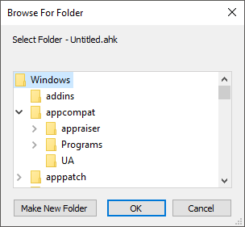

# DirSelect

Displays a standard dialog that allows the user to select a folder.

```ahk
SelectedFolder := DirSelect(StartingFolder, Options, Prompt)
```

<a id="Parameters"></a>
## Parameters

**StartingFolder**

Type: [String](../Concepts.md#strings)

If blank or omitted, the dialog's initial selection will be the user's My Documents folder or possibly This PC (formerly My Computer or Computer). A [CLSID folder](../misc/CLSID-List.md) such as `"::{20D04FE0-3AEA-1069-A2D8-08002B30309D}"` (i.e. This PC) may be specified start navigation at a specific special folder.

Otherwise, the most common usage of this parameter is an asterisk followed immediately by the absolute path of the drive or folder to be initially selected. For example, `"*C:\"` would initially select the C drive. Similarly, `"*C:\My Folder"` would initially select that particular folder.

The asterisk indicates that the user is permitted to navigate upward (closer to the root) from the starting folder. Without the asterisk, the user would be forced to select a folder inside *StartingFolder* (or *StartingFolder* itself). One benefit of omitting the asterisk is that *StartingFolder* is initially shown in a tree-expanded state, which may save the user from having to click the first plus sign.

If the asterisk is present, upward navigation may optionally be restricted to a folder other than Desktop. This is done by preceding the asterisk with the absolute path of the uppermost folder followed by exactly one space or tab. For example, `"C:\My Folder *C:\My Folder\Projects"` would not allow the user to navigate any higher than C:\My Folder (but the initial selection would be C:\My Folder\Projects).

**Options**

Type: [Integer](../Concepts.md#numbers)

If omitted, it defaults to 1. Otherwise, specify one of the following numbers:

**0:** The options below are all disabled.

**1:** A button is provided that allows the user to create new folders.

**Add 2** to the above number to provide an edit field that allows the user to type the name of a folder. For example, a value of 3 for this parameter provides both an edit field and a "make new folder" button.

<a id="NewDialog"></a>

**Add 4** to the above number to omit the BIF_NEWDIALOGSTYLE property. Adding 4 ensures that DirSelect will work properly even in a Preinstallation Environment like WinPE or BartPE. However, this prevents the appearance of a "make new folder" button.

If the user types an invalid folder name in the edit field, *SelectedFolder* will be set to the folder selected in the navigation tree rather than what the user entered.

**Prompt**

Type: [String](../Concepts.md#strings)

If blank or omitted, it defaults to `"Select Folder - " A_ScriptName` (i.e. the name of the current script). Otherwise, specify the text displayed in the window to instruct the user what to do.

<a id="Return_Value"></a>
## Return Value

Type: [String](../Concepts.md#strings)

This function returns the full path and name of the folder chosen by the user. If the user cancels the dialog (i.e. does not wish to select a folder), an empty string is returned. If the user selects a root directory (such as C:\\), the return value will contain a trailing backslash. If this is undesirable, remove it as follows:

```ahk
Folder := RegExReplace(DirSelect(), "\\$")  ; Removes the trailing backslash, if present.
```

An empty string is also returned if the system refused to show the dialog, but this is very rare.

<a id="Remarks"></a>
## Remarks

A folder-selection dialog usually looks like this:



A GUI window may display a modal folder-selection dialog by means of the [+OwnDialogs](Gui.md#OwnDialogs) option. A modal dialog prevents the user from interacting with the GUI window until the dialog is dismissed.

<a id="Related"></a>
## Related

[FileSelect](FileSelect.md), [MsgBox](MsgBox.md), [InputBox](InputBox.md), [ToolTip](ToolTip.md), [GUI](Gui.md), [CLSID List](../misc/CLSID-List.md), [DirCopy](DirCopy.md), [DirMove](DirMove.md), [SplitPath](SplitPath.md)

Also, the operating system offers standard dialog boxes that prompt the user to pick a font, color, or icon. These dialogs can be displayed via [DllCall](DllCall.md) in combination with [comdlg32\ChooseFont](https://learn.microsoft.com/previous-versions/windows/desktop/legacy/ms646914(v=vs.85)), [comdlg32\ChooseColor](https://learn.microsoft.com/previous-versions/windows/desktop/legacy/ms646912(v=vs.85)), or [shell32\PickIconDlg](https://learn.microsoft.com/windows/win32/api/shlobj_core/nf-shlobj_core-pickicondlg). Search the forums for examples.

<a id="Examples"></a>
## Examples

<a id="ExBasic"></a>

**Example:** Allows the user to select a folder and provides both an edit field and a "make new folder" button.

```ahk
SelectedFolder := DirSelect(, 3)
if SelectedFolder = ""
    MsgBox "You didn't select a folder."
else
    MsgBox "You selected folder '" SelectedFolder "'."
```

<a id="ExCLSID"></a>

**Example:** A [CLSID](../misc/CLSID-List.md) example. Allows the user to select a folder in This PC (formerly My Computer or Computer).

```ahk
SelectedFolder := DirSelect("::{20D04FE0-3AEA-1069-A2D8-08002B30309D}")
```
