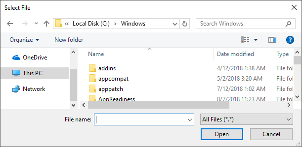

# FileSelect

Displays a standard dialog that allows the user to open or save file(s).

```ahk
SelectedFile := FileSelect(Options, RootDir\Filename, Title, Filter)
```

<a id="Parameters"></a>
## Parameters

**Options**

Type: [String](../Concepts.md#strings) or [Integer](../Concepts.md#numbers)

If blank or omitted, it defaults to zero, which is the same as having none of the options below. Otherwise, specify a number or one of the letters listed below, optionally followed by a number. For example, `"M"`, `1` and `"M1"` are all valid (but not equivalent).

<a id="D"></a>

**D:** Select Folder (Directory). Specify the letter D to allow the user to select a folder rather than a file. The dialog has most of the same features as when selecting a file, but does not support filters (*Filter* must be blank or omitted).

<a id="M"></a>

**M:** Multi-select. Specify the letter M to allow the user to select more than one file via shift-click, control-click, or other means. In this case, the return value is an [Array](Array.md) instead of a string. To extract the individual files, see the example at the bottom of this page.

<a id="S"></a>

**S:** Save dialog. Specify the letter S to cause the dialog to always contain a Save button instead of an Open button.

The following numbers can be used. To put more than one of them into effect, add them up. For example, to use 1 and 2, specify the number 3.

**1:** File Must Exist<br> **2:** Path Must Exist<br> **8:** Prompt to Create New File<br> **16:** Prompt to Overwrite File<br> **32:** Shortcuts (.lnk files) are selected as-is rather than being resolved to their targets. This option also prevents navigation into a folder via a folder shortcut.

As the "Prompt to Overwrite" option is supported only by the Save dialog, specifying that option without the "Prompt to Create" option also puts the S option into effect. Similarly, the "Prompt to Create" option has no effect when the S option is present. Specifying the number 24 enables whichever type of prompt is supported by the dialog.

**RootDir\Filename**

Type: [String](../Concepts.md#strings)

If blank or omitted, the starting directory will be a default that might depend on the OS version (it will likely be the directory most recently selected by the user during a prior use of FileSelect). Otherwise, specify one or both of the following:

**RootDir:** The root (starting) directory, which is assumed to be a subfolder in [A_WorkingDir](../Variables.md#WorkingDir) if an absolute path is not specified.

**Filename:** The default filename to initially show in the dialog's edit field. Only the naked filename (with no path) will be shown. To ensure that the dialog is properly shown, ensure that no illegal characters are present (such as `/<|:"`).

Examples:

```ahk
"C:\My Pictures\Default Image Name.gif"  ; Both RootDir and Filename are present.
"C:\My Pictures"  ; Only RootDir is present.
"My Pictures"  ; Only RootDir is present, and it's relative to the current working directory.
"My File"  ; Only Filename is present (but if "My File" exists as a folder, it is assumed to be RootDir).
```

**Title**

Type: [String](../Concepts.md#strings)

If blank or omitted, it defaults to `"Select File - " A_ScriptName` (i.e. the name of the current script), unless the "D" option is present, in which case the word "File" is replaced with "Folder". Otherwise, specify the title of the file-selection window.

**Filter**

Type: [String](../Concepts.md#strings)

If blank or omitted, the dialog will show all type of files and provide the "All Files (\*.\*)" option in the "Files of type" drop-down list.

Otherwise, specify a string to indicate which types of files are shown by the dialog, e.g. `"Documents (*.txt)"`. To include more than one file extension in the filter, separate them with semicolons, e.g. `"Audio (*.wav; *.mp2; *.mp3)"`. In this case, the "Files of type" drop-down list has the specified string and "All Files (\*.\*)" as options.

This parameter must be blank or omitted if the "D" option is present.

<a id="Return_Value"></a>
## Return Value

Type: [String](../Concepts.md#strings) or [Array](Array.md)

If multi-select is not in effect, this function returns the full path and name of the single file or folder chosen by the user, or an empty string if the user cancels the dialog.

If the M option (multi-select) is in effect, this function returns an array of items, where each item is the full path and name of a single file. The example at the bottom of this page demonstrates how to extract the files one by one. If the user cancels the dialog, the array is empty (has zero items).

<a id="Remarks"></a>
## Remarks

A file-selection dialog usually looks like this:



A GUI window may display a modal file-selection dialog by means of the [+OwnDialogs](Gui.md#OwnDialogs) option. A modal dialog prevents the user from interacting with the GUI window until the dialog is dismissed.

<a id="Related"></a>
## Related

[DirSelect](DirSelect.md), [MsgBox](MsgBox.md), [InputBox](InputBox.md), [ToolTip](ToolTip.md), [GUI](Gui.md), [CLSID List](../misc/CLSID-List.md), [parsing loop](LoopParse.md), [SplitPath](SplitPath.md)

Also, the operating system offers standard dialog boxes that prompt the user to pick a font, color, or icon. These dialogs can be displayed via [DllCall](DllCall.md) in combination with [comdlg32\ChooseFont](https://learn.microsoft.com/previous-versions/windows/desktop/legacy/ms646914(v=vs.85)), [comdlg32\ChooseColor](https://learn.microsoft.com/previous-versions/windows/desktop/legacy/ms646912(v=vs.85)), or [shell32\PickIconDlg](https://learn.microsoft.com/windows/win32/api/shlobj_core/nf-shlobj_core-pickicondlg). Search the forums for examples.

<a id="Examples"></a>
## Examples

<a id="ExBasic"></a>

**Example:** Allows the user to select an existing .txt or .doc file.

```ahk
SelectedFile := FileSelect(3, , "Open a file", "Text Documents (*.txt; *.doc)")
if SelectedFile = ""
    MsgBox "The dialog was canceled."
else
    MsgBox "The following file was selected:`n" SelectedFile
```

<a id="ExMulti"></a>

**Example:** Allows the user to select multiple existing files.

```ahk
SelectedFiles := FileSelect("M3")  ; M3 = Multiselect existing files.
if SelectedFiles.Length = 0
{
    MsgBox "The dialog was canceled."
    return
}
for FileName in SelectedFiles
{
    Result := MsgBox("File #" A_Index " of " SelectedFiles.Length ":`n" FileName "`n`nContinue?",, "YN")
    if Result = "No"
        break
}
```

<a id="ExFolder"></a>

**Example:** Allows the user to select a folder.

```ahk
SelectedFolder := FileSelect("D", , "Select a folder")
if SelectedFolder = ""
    MsgBox "The dialog was canceled."
else
    MsgBox "The following folder was selected:`n" SelectedFolder
```
