# GUI Control Types

GUI control types are elements of interaction which can be added to a GUI window using [Gui.Add](Gui.md#Add).

<a id="toc"></a>
## Table of Contents

- [ActiveX](#ActiveX)
- [Button](#Button)
- [CheckBox](#CheckBox)
- [ComboBox](#ComboBox)
- [Custom](#Custom)
- [DateTime](#DateTime)
- [DropDownList](#DropDownList)
- [Edit](#Edit)
- [GroupBox](#GroupBox)
- [Hotkey](#Hotkey)
- [Link](#Link)
- [ListBox](#ListBox)
- [ListView](#ListView)
- [MonthCal](#MonthCal)
- [Picture](#Picture)
- [Progress](#Progress)
- [Radio](#Radio)
- [Slider](#Slider)
- [StatusBar](#StatusBar)
- [Tab](#Tab)
- [Text](#Text)
- [TreeView](#TreeView)
- [UpDown](#UpDown)

<a id="ActiveX"></a>
## ActiveX

Allows embedding ActiveX components such as the MSIE browser control into a GUI window.

Syntax:

```ahk
GuiCtrl := MyGui.Add("ActiveX", Options, ComponentName)
GuiCtrl := MyGui.AddActiveX(Options, ComponentName)
```

Example:

```ahk
WB := MyGui.Add("ActiveX", "w980 h640", "Shell.Explorer")
```

<a id="ActiveX_Parameters"></a>
### ActiveX Parameters

**Options**

Type: [String](../Concepts.md#strings)

See [general options and styles](Gui.md#Add_Options).

**ComponentName**

Type: [String](../Concepts.md#strings)

The name of the ActiveX component.

<a id="ActiveX_Remarks"></a>
### ActiveX Remarks

When the control is created, the ActiveX object can be retrieved via [GuiControl.Value](GuiControl.md#Value).

To handle the events exposed by the ActiveX object, use [ComObjConnect](ComObjConnect.md).

To determine the type of the ActiveX object, use [ComObjType](ComObjType.md).

[Gui example #10](Gui.md#ExWebBrowser) demonstrates a simple web browser created via the [WebBrowser control](https://learn.microsoft.com/dotnet/desktop/winforms/controls/webbrowser-control-windows-forms).

<a id="Button"></a>
## Button

A pushbutton, which can be pressed to trigger an action.

Syntax:

```ahk
GuiCtrl := MyGui.Add("Button", Options, Name)
GuiCtrl := MyGui.AddButton(Options, Name)
```

Example:

```ahk
MyBtn := MyGui.Add("Button", "Default w80", "OK")
MyBtn.OnEvent("Click", MyBtn_Click)  ; Call MyBtn_Click when clicked.
```

Appearance:

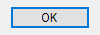

<a id="Button_Parameters"></a>
### Button Parameters

**Options**

Type: [String](../Concepts.md#strings)

In addition to the [general options and styles](Gui.md#Add_Options), the following are supported or noteworthy:

<a id="DefaultButton"></a>

**Default:** Makes the button the default button. The default button's [Click](GuiOnEvent.md#Click) event is automatically triggered whenever the user presses `Enter`, except when the keyboard focus is on a different button or a multi-line edit control having the [WantReturn](#WantReturn) style.

**(Uncommon numeric styles):** See the [Button styles table](../misc/Styles.md#Button) for a list.

**Name**

Type: [String](../Concepts.md#strings)

The display name of the button, which may include linefeeds (\`n) to start new lines.

An ampersand (&) may be used to underline one of the letters, such as the letter P in `"&Pause"`. This allows the user to press `Alt`+`P` as a [shortcut key](Gui.md#ShortcutKey). To display a literal ampersand, specify two consecutive ampersands (&&).

<a id="Button_Remarks"></a>
### Button Remarks

Whenever the user clicks the button or presses `Space` or `Enter` while it has the focus, the [Click](GuiOnEvent.md#Click) event is raised.

The [DoubleClick](GuiOnEvent.md#DoubleClick), [Focus](GuiOnEvent.md#Focus) and [LoseFocus](GuiOnEvent.md#LoseFocus) events are also supported. As these events are only raised if the control has the BS_NOTIFY (0x4000) style, it is added automatically by [GuiControl.OnEvent](GuiControl.md#OnEvent).

Use [GuiControl.Opt](GuiControl.md#Opt) to change the default button later on. For example, `OtherBtn.Opt("+Default")` would change the default button to another button, while `MyBtn.Opt("-Default")` would make the window no longer have a default button.

Known limitation: Certain desktop themes might not display a button's text properly. If this occurs, try including `-Wrap` (minus Wrap) in *Options*. However, this also prevents having more than one line of text.

<a id="Checkbox"></a>

<a id="CheckBox"></a>
## CheckBox

A small box that can be checked or unchecked to represent On/Off, Yes/No, and so on.

Syntax:

```ahk
GuiCtrl := MyGui.Add("CheckBox", Options, Caption)
GuiCtrl := MyGui.AddCheckBox(Options, Caption)
```

Example:

```ahk
MyCB := MyGui.Add("CheckBox",, "Ship to billing address?")
```

Appearance:

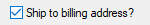

<a id="CheckBox_Parameters"></a>
### CheckBox Parameters

**Options**

Type: [String](../Concepts.md#strings)

In addition to the [general options and styles](Gui.md#Add_Options), the following are supported or noteworthy:

**Check3:** Enables a third state that indicates the checkbox is neither checked nor unchecked.

**Checked:** The checkbox starts off with a checkmark. The word Checked may optionally be followed immediately by a 0, 1, or -1 (or the word Gray) to indicate the starting state (unchecked, checked, or indeterminate). In other words, `"Checked"` and `"Checked" VarContainingOne` are the same.

**(Uncommon numeric styles):** See the [CheckBox styles table](../misc/Styles.md#Button) for a list.

**Caption**

Type: [String](../Concepts.md#strings)

The label to display to the right of the box. This label is typically used as a prompt or description, and it may include linefeeds (\`n) to start new lines.

An ampersand (&) may be used to underline one of the letters, such as the letter P in `"&Pause"`. This allows the user to press `Alt`+`P` as a [shortcut key](Gui.md#ShortcutKey). To display a literal ampersand, specify two consecutive ampersands (&&).

<a id="CheckBox_Remarks"></a>
### CheckBox Remarks

[GuiControl.Value](GuiControl.md#Value) returns the number 1 for checked, 0 for unchecked, and -1 for indeterminate. [Gui.Submit](Gui.md#Submit) stores the same values.

Whenever the checkbox is clicked, it automatically cycles between its two or three possible states, and then raises the [Click](GuiOnEvent.md#Click) event, allowing the script to immediately respond to the user's input.

The [DoubleClick](GuiOnEvent.md#DoubleClick), [Focus](GuiOnEvent.md#Focus) and [LoseFocus](GuiOnEvent.md#LoseFocus) events are also supported. As these events are only raised if the control has the BS_NOTIFY (0x4000) style, it is added automatically by [GuiControl.OnEvent](GuiControl.md#OnEvent). This style is not applied by default as it prevents rapid clicks from changing the state of the checkmark (such as if the user clicks twice to toggle from unchecked to checked and then to indeterminate).

If a width (W) is specified in *Options* but no [rows (R)](Gui.md#R) or height (H), the control's text will be word-wrapped as needed, and the control's height will be set automatically.

Known limitation: Certain desktop themes might not display a checkbox's text properly. If this occurs, try including `-Wrap` (minus Wrap) in *Options*. However, this also prevents having more than one line of text.

<a id="ComboBox"></a>
## ComboBox

A list of choices that is displayed in response to pressing a small button, but also permits free-form text to be entered as an alternative to picking an item from the list.

Syntax:

```ahk
GuiCtrl := MyGui.Add("ComboBox", Options, Choices)
GuiCtrl := MyGui.AddComboBox(Options, Choices)
```

Example:

```ahk
MyCB := MyGui.Add("ComboBox",, ["Red", "Green", "Blue", "Black", "White"])
```

Appearance:

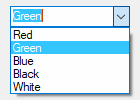

<a id="ComboBox_Parameters"></a>
### ComboBox Parameters

**Options**

Type: [String](../Concepts.md#strings)

In addition to the [general options and styles](Gui.md#Add_Options), the following are supported or noteworthy:

**Choose***N*: Specify for *N* the number of an item to be pre-selected. For example, `Choose5` would pre-select the fifth item (as with other options, it can also be a variable such as `"Choose" Var`). To change the choice after the control has been created, use [GuiControl.Choose](GuiControl.md#Choose).

**Uppercase** or **Lowercase**: Converts all items in the list to uppercase or lowercase.

**Sort:** Sorts the contents of the list alphabetically, which also affects any items added later via [GuiControl.Add](GuiControl.md#Add). The Sort option also enables incremental searching whenever the list is dropped down; this allows an item to be selected by typing the first few characters of its name.

**Limit:** Restricts the user's input to the visible width of the ComboBox's edit field.

**Simple:** Makes the ComboBox behave as though it is an edit field with a [ListBox](#ListBox) beneath it.

**W***n*: Sets the width of the control. For example, specifying `w400` would make the control 400 pixels wide. If omitted, the default is 15 times the current font size.

**R***n* or **H***n*: Sets the height of the popup list. For example, specifying `r7` would make the list 7 rows tall, while `h400` would set the total height of the selection field and list to 400 pixels. If both R and H are omitted, the list will automatically expand to take advantage of the available height of the user's desktop.

**(Uncommon numeric styles):** See the [ComboBox styles table](../misc/Styles.md#DDL) for a list.

**Choices**

Type: [Array](Array.md)

An array of choices such as `["Red", "Green", "Blue"]`. To add or remove choices after the control has been created, use [GuiControl.Add](GuiControl.md#Add) or [GuiControl.Delete](GuiControl.md#Delete).

<a id="ComboBox_Remarks"></a>
### ComboBox Remarks

[GuiControl.Value](GuiControl.md#Value) returns the index of the currently selected item (the first item is 1, the second is 2, etc.) or 0 if the control contains text which does not match a list item, while [GuiControl.Text](GuiControl.md#Text) returns the contents of the ComboBox's edit field. [Gui.Submit](Gui.md#Submit) stores the text, unless the control has the [AltSubmit](Gui.md#AltSubmit) option and the text matches a list item, in which case it stores the index of the item.

Whenever the user selects a new item or changes the control's text, the [Change](GuiOnEvent.md#Change) event is raised. The [Focus](GuiOnEvent.md#Focus) and [LoseFocus](GuiOnEvent.md#LoseFocus) events are also supported.

<a id="ComboBoxHeight"></a>

To set the height of the selection field or list items, use the [CB_SETITEMHEIGHT](https://learn.microsoft.com/windows/win32/controls/cb-setitemheight) message as in the example below:

```ahk
MyGui := Gui()
MyCB := MyGui.Add("ComboBox", "w200 Choose1", ["One", "Two"])
; CB_SETITEMHEIGHT = 0x0153
SendMessage(0x0153, -1, 50, MyCB)  ; Set height of selection field.
SendMessage(0x0153, 0, 50, MyCB)  ; Set height of list items.
MyGui.Show("h70")
```

On a related note, if you want to automate the process of showing and hiding the popup list later on, use [ControlShowDropDown](ControlShowDropDown.md) and [ControlHideDropDown](ControlHideDropDown.md).

<a id="Custom"></a>
## Custom

Allows embedding controls that are not directly supported by AutoHotkey into a GUI window.

Syntax:

```ahk
GuiCtrl := MyGui.Add("Custom", Options, Text)
GuiCtrl := MyGui.AddCustom(Options, Text)
```

Example:

```ahk
MyCBEx := MyGui.Add("Custom", "ClassComboBoxEx32")
```

<a id="Custom_Parameters"></a>
### Custom Parameters

**Options**

Type: [String](../Concepts.md#strings)

In addition to the [general options and styles](Gui.md#Add_Options), the following are supported or noteworthy:

**Class***Name*: Specify for *Name* the Win32 class name of the desired control. For example, `ClassComboBoxEx32` which adds a [ComboBoxEx control](https://learn.microsoft.com/windows/win32/controls/comboboxex-control-reference), or `ClassScintilla` which adds a [Scintilla control](https://scintilla.org/) (note that the SciLexer.dll library must be loaded beforehand).

**W***n*: Sets the width of the control. For example, specifying `w400` would make the control 400 pixels wide. If omitted, the default is 30 times the current font size.

**R***n* or **H***n*: Sets the height of the control. For example, specifying `r7` would make room for 7 rows inside the control, while `h400` would set the total height of the control to 400 pixels. If both R and H are omitted, the default is 5 rows.

**Text**

Type: [String](../Concepts.md#strings)

Any text. It may or may not be ignored depending on the nature of the custom control.

AutoHotkey uses the standard Windows control text routines when text is to be retrieved/replaced in the control via [Gui.Add](Gui.md#Add) or [GuiControl.Value](GuiControl.md#Value).

<a id="Custom_Remarks"></a>
### Custom Remarks

Since the meaning of each notification code depends on the control which sent it, [GuiControl.OnEvent](GuiControl.md#OnEvent) is not supported for Custom controls. However, if the control sends notifications in the form of a WM_NOTIFY or WM_COMMAND message, the script can use [GuiControl.OnNotify](GuiControl.md#OnNotify) or [GuiControl.OnCommand](GuiControl.md#OnCommand) to detect them.

[Gui example #11](Gui.md#ExIPAddress) demonstrates how to add and use an [IP address control](https://learn.microsoft.com/windows/win32/controls/ip-address-control-reference).

<a id="DateTime"></a>
## DateTime

A box that looks like a single-line edit control but instead accepts a date and/or time. A drop-down calendar is also provided.

Syntax:

```ahk
GuiCtrl := MyGui.Add("DateTime", Options, Format)
GuiCtrl := MyGui.AddDateTime(Options, Format)
```

Example:

```ahk
MyDT := MyGui.Add("DateTime",, "LongDate")
```

Appearance:

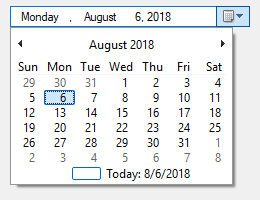

<a id="DateTime_Parameters"></a>
### DateTime Parameters

<a id="DateTime_Options"></a>

**Options**

Type: [String](../Concepts.md#strings)

In addition to the [general options and styles](Gui.md#Add_Options), the following are supported or noteworthy:

<a id="DateTime_Choose"></a>

**Choose***Timestamp*: Specify for *Timestamp* a date in [YYYYMMDD](FileSetTime.md#YYYYMMDD) format to have a date other than today pre-selected. For example, `Choose20050531` would pre-select May 31, 2005 (as with other options, it can also be a variable such as `"Choose" Var`). The time of day may optionally be present (see the remarks below for details). Specify for *Timestamp* the word None, to have no date/time selected. `ChooseNone` also creates a checkbox inside the control that is unchecked whenever the control has no date. Whenever the control has no date, [GuiControl.Value](GuiControl.md#Value) will return a blank value (empty string). To change the selection after the control has been created, use [GuiControl.Value](GuiControl.md#Value).

**Range***MinMax*: Restricts how far back or forward in time the selected date can be. Specify for *MinMax* the minimum and maximum dates in [YYYYMMDD](FileSetTime.md#YYYYMMDD) format (with a dash between them). For example, `Range20050101-20050615` would restrict the date to the first 5.5 months of 2005. Either the minimum or maximum may be omitted to leave the control unrestricted in that direction. For example, `Range20010101` would prevent a date prior to 2001 from being selected, and `Range-20091231` (leading dash) would prevent a date later than 2009 from being selected. Without the Range option, any date between the years 1601 and 9999 can be selected. The time of day cannot be restricted.

**Right:** Causes the drop-down calendar to drop down on the right side of the control instead of the left.

**1:** Provides an up-down control to the right of the control to modify date-time values, which replaces the button of the drop-down month calendar that would otherwise be available. This does not work in conjunction with the [LongDate](#DateTime_LongDate) format.

<a id="ChooseNone"></a>

**2:** Provides a checkbox inside the control that the user may uncheck to indicate that no date/time is selected. Once the control is created, this option cannot be changed.

**W***n*: Sets the width of the control. For example, specifying `w400` would make the control 400 pixels wide. If omitted, the default is 30 times the current font size.

**R***n* or **H***n*: Sets the height of the control. For example, specifying `r7` would make room for 7 rows inside the control, while `h400` would set the total height of the control to 400 pixels. If both R and H are omitted, the default is 1 row.

**(Uncommon numeric styles):** See the [DateTime styles table](../misc/Styles.md#DateTime) for a list.

<a id="DateTimeFormat"></a>

**Format**

Type: [String](../Concepts.md#strings)

If blank or omitted, it defaults to *ShortDate*. Otherwise, specify one of the following formats for initial display. To change the format after the control has been created, use its [SetFormat](#DateTime_SetFormat) method.

**ShortDate:** Uses the locale's short date format. For example, in some locales, it would look like: 6/1/2005

<a id="DateTime_LongDate"></a>

**LongDate:** Uses the locale's long date format. For example, in some locales, it would look like: Wednesday, June 01, 2005

**Time:** Shows only the time using the locale's time format. Although the date is not shown, it is still present in the control and will be retrieved along with the time in the [YYYYMMDDHH24MISS](FileSetTime.md#YYYYMMDD) format. For example, in some locales, it would look like: 9:37:45 PM

**(custom format):** Specify any combination of [date and time formats](FormatTime.md). For example, `"M/d/yy HH:mm"` would look like 6/1/05 21:37. Similarly, `"dddd MMMM d, yyyy hh:mm:ss tt"` would look like Wednesday June 1, 2005 09:37:45 PM. Letters and numbers to be displayed literally should be enclosed in single quotes, as in this example: `"'Date:' MM/dd/yy 'Time:' hh:mm:ss tt"`. By contrast, non-alphanumeric characters such as spaces, tabs, slashes, colons, commas, and other punctuation do not need to be enclosed in single quotes. The exception to this is the single quote character itself: To produce it literally, use four consecutive single quotes (''''), or just two if the quote is already inside an outer pair of quotes.

<a id="DateTime_Methods"></a>
### DateTime Methods

In addition to the [default methods/properties of a GUI control](GuiControl.md), this control type has the following methods:

- [SetFormat](#DateTime_SetFormat): Sets the display format of a DateTime control.

<a id="DateTime_SetFormat"></a>

### SetFormat

Sets the display format of a DateTime control.

```ahk
GuiCtrl.SetFormat(Format)
```

*Format* is a [format string](#DateTimeFormat), as described above. This method allows to change the display format after the DateTime control has been created.

<a id="DateTime_Remarks"></a>
### DateTime Remarks

The time of day may optionally be present for the [Choose](#DateTime_Choose) option. However, it must always be preceded by a date when going into or coming out of the control. The format of the time portion is HH24MISS (hours, minutes, seconds), where HH24 is expressed in 24-hour format; for example, 09 is 9am and 21 is 9pm. Thus, a complete date-time string would have the format [YYYYMMDDHH24MISS](FileSetTime.md#YYYYMMDD).

When specifying dates in the YYYYMMDDHH24MISS format, only the leading part needs to be present. Any remaining element that has been omitted will be supplied with the following default values: MM with month 01, DD with day 01, HH24 with hour 00, MI with minute 00 and SS with second 00.

Within the drop-down calendar, the today-string at the bottom can be clicked to select today's date. In addition, the year and month names are clickable and allow easy navigation to a new month or year.

<a id="DateTime_Keyboard_Navigation"></a>

Keyboard navigation: Use the `↑`/`↓` arrow keys, the `+`/`-` numpad keys, and `Home`/`End` to increase or decrease the control's values. Use `←` and `→` to move from field to field inside the control. Within the drop-down calendar, use the arrow keys to move from day to day; use `PgUp`/`PgDn` to move backward/forward by one month; and use `Home`/`End` to select the first/last day of the month.

[GuiControl.Value](GuiControl.md#Value) returns the selected date and time in [YYYYMMDDHH24MISS](FileSetTime.md#YYYYMMDD) format. Both the date and the time are present regardless of whether they were actually visible in the control. [Gui.Submit](Gui.md#Submit) stores the same value.

Whenever the user changes the date or time, the [Change](GuiOnEvent.md#Change) event is raised. The [Focus](GuiOnEvent.md#Focus) and [LoseFocus](GuiOnEvent.md#LoseFocus) events are also supported.

To change the colors of any part of the drop-down calendar, use [SendMessage](SendMessage.md) as in this example:

```ahk
DTM_SETMCCOLOR    := 0x1006

MCSC_BACKGROUND   := 0 ; overall background
MCSC_MONTHBK      := 4 ; the month's background
MCSC_TEXT         := 1 ; the month's text
MCSC_TITLEBK      := 2 ; the title's background
MCSC_TITLETEXT    := 3 ; the title's text
MCSC_TRAILINGTEXT := 5 ; the other months' text

BackColor := 0xFFAA99 ; The calendar's new background color (BGR, not RGB).
TextColor := 0x0066CC ; The calendar's new text color (BGR, not RGB).

MyGui := Gui()
MyDT := MyGui.Add("DateTime")
MyDT.OnNotify(-754, DTN_DROPDOWN) ; Force Classic Theme appearance.
SendMessage(DTM_SETMCCOLOR, MCSC_MONTHBK, BackColor, MyDT)
SendMessage(DTM_SETMCCOLOR, MCSC_TEXT, TextColor, MyDT)
MyGui.Show()

DTN_DROPDOWN(MyDT, lParam) {
    hCal := SendMessage(0x1008, 0, 0, MyDT) ; 0x1008 is DTM_GETMONTHCAL.
    DllCall("UxTheme\SetWindowTheme", "Ptr", hCal, "WStr", "", "WStr", "")
}
```

<a id="DDL"></a>

<a id="DropDownList"></a>
## DropDownList

A list of choices that is displayed in response to pressing a small button.

Syntax:

```ahk
GuiCtrl := MyGui.Add("DropDownList", Options, Choices)
GuiCtrl := MyGui.AddDropDownList(Options, Choices)
```

Example:

```ahk
MyDDL := MyGui.Add("DropDownList",, ["Black", "White", "Red", "Green", "Blue"])
```

Appearance:

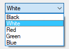

<a id="DropDownList_Parameters"></a>
### DropDownList Parameters

**DropDownList**

The control type name can be either DropDownList or DDL.

**Options**

Type: [String](../Concepts.md#strings)

In addition to the [general options and styles](Gui.md#Add_Options), the following are supported or noteworthy:

**Choose***N*: Specify for *N* the number of an item to be pre-selected. For example, `Choose5` would pre-select the fifth item (as with other options, it can also be a variable such as `"Choose" Var`). To change the choice after the control has been created, use [GuiControl.Choose](GuiControl.md#Choose).

**Uppercase** or **Lowercase**: Converts all items in the list to uppercase or lowercase.

**Sort:** Sorts the contents of the list alphabetically, which also affects any items added later via [GuiControl.Add](GuiControl.md#Add). The Sort option also enables incremental searching whenever the list is dropped down; this allows an item to be selected by typing the first few characters of its name.

**W***n*: Sets the width of the control. For example, specifying `w400` would make the control 400 pixels wide. If omitted, the default is 15 times the current font size.

**R***n* or **H***n*: Sets the height of the popup list. For example, specifying `r7` would make the list 7 rows tall, while `h400` would set the total height of the selection field and list to 400 pixels. If both R and H are omitted, the list will automatically expand to take advantage of the available height of the user's desktop.

**(Uncommon numeric styles):** See the [DropDownList styles table](../misc/Styles.md#DDL) for a list.

**Choices**

Type: [Array](Array.md)

An array of choices such as `["Red", "Green", "Blue"]`. To add or remove choices after the control has been created, use [GuiControl.Add](GuiControl.md#Add) or [GuiControl.Delete](GuiControl.md#Delete).

<a id="DropDownList_Remarks"></a>
### DropDownList Remarks

[GuiControl.Value](GuiControl.md#Value) returns the index of the currently selected item (the first item is 1, the second is 2, etc.) or 0 if there is no item selected, while [GuiControl.Text](GuiControl.md#Text) returns the text of the currently selected item. [Gui.Submit](Gui.md#Submit) stores the text, unless the control has the [AltSubmit](Gui.md#AltSubmit) option, in which case it stores the index of the item.

Whenever the user selects a new item, the [Change](GuiOnEvent.md#Change) event is raised. The [Focus](GuiOnEvent.md#Focus) and [LoseFocus](GuiOnEvent.md#LoseFocus) events are also supported.

To set the height of the selection field or list items, use the [CB_SETITEMHEIGHT](https://learn.microsoft.com/windows/win32/controls/cb-setitemheight) message as in the example below:

```ahk
MyGui := Gui()
MyDDL := MyGui.Add("DDL", "w200 Choose1", ["One", "Two"])
; CB_SETITEMHEIGHT = 0x0153
SendMessage(0x0153, -1, 50, MyDDL)  ; Set height of selection field.
SendMessage(0x0153, 0, 50, MyDDL)  ; Set height of list items.
MyGui.Show("h70")
```

On a related note, if you want to automate the process of showing and hiding the popup list later on, use [ControlShowDropDown](ControlShowDropDown.md) and [ControlHideDropDown](ControlHideDropDown.md).

<a id="Edit"></a>
## Edit

An area where free-form text can be typed by the user.

Syntax:

```ahk
GuiCtrl := MyGui.Add("Edit", Options, Text)
GuiCtrl := MyGui.AddEdit(Options, Text)
```

Example:

```ahk
MyEdit := MyGui.Add("Edit", "r9 w135", "Text to appear inside the edit control (omit this parameter to start off empty).")
```

Appearance:

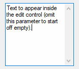

<a id="Edit_Parameters"></a>
### Edit Parameters

<a id="Edit_Options"></a>

**Options**

Type: [String](../Concepts.md#strings)

In addition to the [general options and styles](Gui.md#Add_Options), the following are supported or noteworthy:

**Limit***N*: Restricts the user's input. If *N* is omitted, input is restricted to the visible width of the edit field. Otherwise, specify for *N* a specific number of characters to limit input. For example, `Limit10` would allow no more than 10 characters to be entered.

**Uppercase** or **Lowercase**: The characters typed by the user are automatically converted to uppercase or lowercase.

<a id="EditMulti"></a>

**Multi:** Makes it possible to have more than one line of text. However, it is usually not necessary to specify this because the control is auto-detected as multi-line if *Text* containing multiple lines, its [height](#Edit_R) being taller than its default row height, or its [row-count](#Edit_R) having been explicitly specified as greater than 1. For example, specifying `r3` in *Options* will create a 3-line edit control with the following default properties: a vertical scroll bar, word-wrapping enabled, and `Enter` captured as part of the input rather than triggering the window's [default button](#DefaultButton).

<a id="EditNum"></a>

**Number:** Prevents the user from typing anything other than digits into the field (however, it is still possible to paste non-digits into it). An alternate way of forcing a numeric entry is to attach an [UpDown](#UpDown) control to the Edit.

**Password:** Hides the user's input (such as for password entry) by substituting masking characters for what the user types. If a non-default masking character is desired, include it immediately after the word Password. For example, `Password*` would make the masking character an asterisk rather than the black circle (bullet). Note that this option has no effect for [multi-line](#EditMulti) edit controls.

**ReadOnly:** Prevents the user from changing the control's contents. However, the text can still be scrolled, selected, and copied to the clipboard.

**T***n*: Sets a tab stop inside a [multi-line](#EditMulti) edit control (since tab stops determine the column positions to which literal tab characters will jump, they can be used to format the text into columns). If the T option is not used, tab stops are set at every 32 dialog units (the width of each "dialog unit" is determined by the operating system). If the T option is used only once, tab stops are set at every *n* units across the entire width of the control. For example, `t64` would double the default distance between tab stops. To have custom tab stops, specify the T option multiple times, e.g. `t8 t16 t32 t64 t128`. One tab stop is set for each of the absolute column positions in the list, up to a maximum of 50 tab stops.

**WantCtrlA:** Specify `-WantCtrlA` (minus WantCtrlA) to prevent the user's press of `Ctrl`+`A` from selecting all text in the edit control.

<a id="WantReturn"></a>

**WantReturn:** Specify `-WantReturn` (minus WantReturn) to prevent a [multi-line](#EditMulti) edit control from capturing `Enter`. Pressing `Enter` will then be the same as pressing the window's [default button](#DefaultButton) (if any). In this case, the user may press `Ctrl`+`Enter` to start a new line.

**WantTab:** Causes `Tab` to produce a tab character rather than navigating to the next control. Without this option, the user may press `Ctrl`+`Tab` to produce a tab character inside a [multi-line](#EditMulti) edit control. Note that WantTab also works in a single-line edit control.

**Wrap:** Specify `-Wrap` (minus Wrap) to turn off word-wrapping in a [multi-line](#EditMulti) edit control. Since this style cannot be changed after the control has been created, use one of the following to change it: 1) [Destroy](Gui.md#Destroy) then recreate the window and its control; or 2) Create two overlapping edit controls, one with wrapping enabled and the other without it. The one not currently in use can be kept empty and/or hidden.

**W***n*: Sets the width of the control. For example, specifying `w400` would make the control 400 pixels wide. If omitted, empty edit controls default to 15 times the current font size. Non-empty edit controls default to the width of the longest line.

<a id="Edit_R"></a>

**R***n* or **H***n*: Sets the height of the control. For example, specifying `r7` would make room for 7 rows inside the control, while `h400` would set the total height of the control to 400 pixels. If both R and H are omitted, single-line edit controls default to 1 row, while empty [multi-line](#EditMulti) edit controls default to 3 rows. Non-empty edit controls default to a height based on the number of lines they contain.

**(Uncommon numeric styles):** See the [Edit styles table](../misc/Styles.md#Edit) for a list.

**Text**

Type: [String](../Concepts.md#strings)

If blank or omitted, the control starts off empty. Otherwise, specify the text to appear inside the control.

To start a new line, include either a solitary linefeed (\`n) or a carriage return and linefeed (\`r\`n). Both methods produce literal \`r\`n pairs inside the edit control. However, when the control's content is retrieved via [GuiControl.Value](GuiControl.md#Value) or [Gui.Submit](Gui.md#Submit), each \`r\`n in the text is always translated to a plain linefeed (\`n). To bypass this end-of-line translation, use [GuiControl.Text](GuiControl.md#Text). In addition, a single long line can be broken up into several shorter ones by means of a [continuation section](../Scripts.md#continuation).

<a id="Edit_Remarks"></a>
### Edit Remarks

Whenever the user changes the control's content, the [Change](GuiOnEvent.md#Change) event is raised.

If the control has word-wrapping enabled (which is the default for [multi-line](#EditMulti) edit controls), any wrapping that occurs as the user types will not produce linefeed characters (only `Enter` can do that).

To load a text file into an edit control, use [FileRead](FileRead.md) and [GuiControl.Value](GuiControl.md#Value):

```ahk
MyEdit := MyGui.Add("Edit", "r20")
MyEdit.Value := FileRead("C:\My File.txt")
```

<a id="GroupBox"></a>
## GroupBox

A rectangular border/frame, often used around other controls to indicate they are related.

Syntax:

```ahk
GuiCtrl := MyGui.Add("GroupBox", Options, Title)
GuiCtrl := MyGui.AddGroupBox(Options, Title)
```

Example:

```ahk
MyGB := MyGui.Add("GroupBox", "w200 h100", "Geographic Criteria")
```

Appearance:

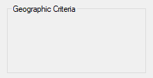

<a id="GroupBox_Parameters"></a>
### GroupBox Parameters

**Options**

Type: [String](../Concepts.md#strings)

In addition to the [general options and styles](Gui.md#Add_Options), the following are supported or noteworthy:

**Wrap:** Allows *Title* to have more than one line of text.

**W***n*: Sets the width of the control. For example, specifying `w400` would make the control 400 pixels wide. If omitted, the default is 15 times the current font size, plus 2 times the [X-margin](Gui.md#MarginX).

**R***n* or **H***n*: Sets the height of the control. For example, specifying `r7` would make room for 7 rows inside the control, while `h400` would set the total height of the control to 400 pixels. If both R and H are omitted, the default is 2 rows.

**(Uncommon numeric styles):** See the [GroupBox styles table](../misc/Styles.md#Button) for a list.

**Title**

Type: [String](../Concepts.md#strings)

The title of the box, which if present is displayed at its upper-left edge.

An ampersand (&) may be used to underline one of the letters, such as the letter C in `"&Criteria"`. This allows the user to press the [shortcut key](Gui.md#ShortcutKey) `Alt`+`C` to set keyboard focus to the first input-capable control that was added after the GroupBox control. To display a literal ampersand, specify two consecutive ampersands (&&).

<a id="Hotkey"></a>
## Hotkey

A box that looks like a single-line edit control but instead accepts a keyboard combination pressed by the user. For example, if the user presses `Ctrl`+`Alt`+`C`, the box would display "Ctrl + Alt + C".

Syntax:

```ahk
GuiCtrl := MyGui.Add("Hotkey", Options, KeyName)
GuiCtrl := MyGui.AddHotkey(Options, KeyName)
```

Example:

```ahk
MyHotkey := MyGui.Add("Hotkey",, "^!c")
```

Appearance:

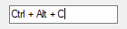

<a id="Hotkey_Parameters"></a>
### Hotkey Parameters

**Options**

Type: [String](../Concepts.md#strings)

In addition to the [general options and styles](Gui.md#Add_Options), the following are supported or noteworthy:

**Limit***N*: Specify for *N* the sum of one or more of the following numbers to restrict the types of hotkeys the user may enter: 1 to prevent unmodified keys, 2 to prevent `Shift`-only keys, 4 to prevent `Ctrl`-only keys, 8 to prevent `Alt`-only keys, 16 to prevent `Shift`+`Ctrl` keys, 32 to prevent `Shift`+`Alt` keys, and 128 to prevent `Shift`+`Ctrl`+`Alt` keys (64 is not supported; it will not behave correctly). For example, `Limit1` would prevent unmodified hotkeys such as letters and numbers from being entered, and `Limit15` would require at least two modifier keys. If the user types a forbidden modifier combination, the `Ctrl`+`Alt` combination is automatically and visibly substituted.

**W***n*: Sets the width of the control. For example, specifying `w400` would make the control 400 pixels wide. If omitted, the default is 15 times the current font size.

**R***n* or **H***n*: Sets the height of the control. For example, specifying `r7` would make room for 7 rows inside the control, while `h400` would set the total height of the control to 400 pixels. If both R and H are omitted, the default is 1 row.

**KeyName**

Type: [String](../Concepts.md#strings)

If blank or omitted, the control starts off with no hotkey specified. Otherwise, specify its modifiers and name. For example, `^!p` would display "Ctrl + Alt + P". The only modifiers supported are ^ (Control), ! (Alt), and + (Shift). See the [key list](../KeyList.md) for available key names.

Some keys are displayed the same even though they are retrieved as different names. For example, both `^Numpad7` and `^NumpadHome` might be displayed as "Ctrl + Num 7".

<a id="Hotkey_Remarks"></a>
### Hotkey Remarks

[GuiControl.Value](GuiControl.md#Value) returns the control's hotkey modifiers and name, which are compatible with the [Hotkey](Hotkey.md) function. Examples: `^!c`, `+!Home`, `+^Down`, `^Numpad1`, `!NumpadEnd`. If there is no hotkey in the control, the value is blank. [Gui.Submit](Gui.md#Submit) stores the same values.

Whenever the user changes the control's content (by pressing a key), the [Change](GuiOnEvent.md#Change) event is raised. Note that the event is raised even when an incomplete hotkey is present. For example, if the user holds down `Ctrl`, the event is raised once and [GuiControl.Value](GuiControl.md#Value) returns only a circumflex (^). When the user completes the hotkey, the event is raised again and [GuiControl.Value](GuiControl.md#Value) returns the complete hotkey.

The Hotkey control has limited capabilities. For example, it does not support mouse/controller hotkeys or `Win` (LWin and RWin). One way to work around this is to provide one or more [checkboxes](#CheckBox) as a means for the user to enable extra modifiers such as `Win`.

<a id="Link"></a>
## Link

A text control that can contain links similar to those found in a web browser.

Syntax:

```ahk
GuiCtrl := MyGui.Add("Link", Options, String)
GuiCtrl := MyGui.AddLink(Options, String)
```

Example:

<a id="A"></a>
<a id="B"></a>

```ahk
MyLink1 := MyGui.Add("Link",, 'This is a <a href="https://www.autohotkey.com">link</a>')
MyLink2 := MyGui.Add("Link",, 'Links may be used anywhere in the text like <a id="A">this</a> or <a id="B">that</a>')
```

Appearance:

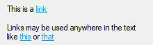

<a id="Link_Parameters"></a>
### Link Parameters

**Options**

Type: [String](../Concepts.md#strings)

In addition to the [general options and styles](Gui.md#Add_Options), the following are supported or noteworthy:

**(Uncommon numeric styles):** See the [Link styles table](../misc/Styles.md#Link) for a list.

**String**

Type: [String](../Concepts.md#strings)

The string to display. Enclose the link text within `<A>` and `</A>` to create a clickable link, optionally with an ID and/or HREF attribute. The string may include linefeeds (\`n) to start new lines. In addition, a single long line can be broken up into several shorter ones by means of a [continuation section](../Scripts.md#continuation).

An ampersand (&) may be used to underline one of the letters, such as the letter F in `"&First Name"`. This allows the user to press the [shortcut key](Gui.md#ShortcutKey) `Alt`+`F` to set keyboard focus to the first input-capable control that was added after the Link control. To display a literal ampersand, specify two consecutive ampersands (&&).

<a id="Link_Remarks"></a>
### Link Remarks

Although this looks like HTML, Link controls only support the opening `<A>` tag (optionally with an ID and/or HREF attribute) and closing `</A>` tag.

If a width (W) is specified in *Options* but no [rows (R)](Gui.md#R) or height (H), the control's text will be word-wrapped as needed, and the control's height will be set automatically.

Whenever the user clicks on a link, the [Click](GuiOnEvent.md#Click) event is raised. If the control has no Click callback (registered by calling [GuiControl.OnEvent](GuiControl.md#OnEvent)), the link's HREF is automatically executed as though passed to the [Run](Run.md) function.

See [OnEvent example #1](GuiOnEvent.md#ExClickLink) for a demonstration.

<a id="ListBox"></a>
## ListBox

A relatively tall box containing a list of choices that can be selected.

Syntax:

```ahk
GuiCtrl := MyGui.Add("ListBox", Options, Choices)
GuiCtrl := MyGui.AddListBox(Options, Choices)
```

Example:

```ahk
MyLB := MyGui.Add("ListBox", "r5", ["Red", "Green", "Blue", "Black", "White"])
```

Appearance:

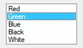

<a id="ListBox_Parameters"></a>
### ListBox Parameters

<a id="ListBox_Options"></a>

**Options**

Type: [String](../Concepts.md#strings)

In addition to the [general options and styles](Gui.md#Add_Options), the following are supported or noteworthy:

<a id="ChooseLB"></a>

**Choose***N*: Specify for *N* the number of an item to be pre-selected. For example, `Choose5` would pre-select the fifth item (as with other options, it can also be a variable such as `"Choose" Var`). To change the choice after the control has been created, use [GuiControl.Choose](GuiControl.md#Choose). If the control has the [Multi](#ListBoxMulti) option, use [GuiControl.Choose](GuiControl.md#Choose) repeatedly to have multiple items pre-selected.

<a id="ListBoxMulti"></a>

**Multi** or **0x8**: Allows more than one item to be selected simultaneously via shift-click and control-click. 0x8 allows the same, but without the need for shift/control-click. If this option is present, [GuiControl.Value](GuiControl.md#Value), [GuiControl.Text](GuiControl.md#Text), and [Gui.Submit](Gui.md#Submit) return/store an [array](Array.md) of selected items. See the remarks below for details.

**ReadOnly:** Prevents items from being visibly highlighted when they are selected, but [GuiControl.Value](GuiControl.md#Value), [GuiControl.Text](GuiControl.md#Text), and [Gui.Submit](Gui.md#Submit) will still return/store the selected item(s).

**Sort:** Sorts the contents of the list alphabetically, which also affects any items added later via [GuiControl.Add](GuiControl.md#Add). The Sort option also enables incremental searching, which allows an item to be selected by typing the first few characters of its name.

**T***n*: Sets a tab stop, which can be used to format the text into columns. If the T option is not used, tab stops are set at every 32 dialog units (the width of each "dialog unit" is determined by the operating system). If the T option is used only once, tab stops are set at every *n* units across the entire width of the control. For example, `t64` would double the default distance between tab stops. To have custom tab stops, specify the T option multiple times, e.g. `t8 t16 t32 t64 t128`. One tab stop is set for each of the absolute column positions in the list, up to a maximum of 50 tab stops.

**0x100:** Applies the LBS_NOINTEGRALHEIGHT style. This forces the ListBox to be exactly the height specified rather than a height that prevents a partial row from appearing at the bottom. This option also prevents the ListBox from shrinking when its font is changed.

**W***n*: Sets the width of the control. For example, specifying `w400` would make the control 400 pixels wide. If omitted, the default is 15 times the current font size.

**R***n* or **H***n*: Sets the height of the control. For example, specifying `r7` would make room for 7 rows inside the control, while `h400` would set the total height of the control to 400 pixels. If both R and H are omitted, the default is 3 rows.

**(Uncommon numeric styles):** See the [ListBox styles table](../misc/Styles.md#ListBox) for a list.

**Choices**

Type: [Array](Array.md)

An array of choices such as `["Red", "Green", "Blue"]`. To add or remove choices after the control has been created, use [GuiControl.Add](GuiControl.md#Add) or [GuiControl.Delete](GuiControl.md#Delete).

<a id="ListBox_Remarks"></a>
### ListBox Remarks

[GuiControl.Value](GuiControl.md#Value) returns the index of the currently selected item (the first item is 1, the second is 2, etc.) or 0 if there is no item selected, while [GuiControl.Text](GuiControl.md#Text) returns the text of the currently selected item. [Gui.Submit](Gui.md#Submit) stores the text, unless the control has the [AltSubmit](Gui.md#AltSubmit) option, in which case it stores the index of the item.

If the control has the [Multi](#ListBoxMulti) option, [GuiControl.Value](GuiControl.md#Value), [GuiControl.Text](GuiControl.md#Text), and [Gui.Submit](Gui.md#Submit) return/store an [array](Array.md) of selected items. For example, `[1, 2, 3]` would indicate that the first three items are selected. To extract the individual items from the array, use `MyLB.Text[1]` (1 would be the first item) or a [For-loop](For.md) such as this example:

```ahk
For Index, Field in MyLB.Text
{
    MsgBox "Selection number " Index " is " Field
}
```

Whenever the user selects or deselects one or more items, the [Change](GuiOnEvent.md#Change) event is raised. The [DoubleClick](GuiOnEvent.md#DoubleClick), [Focus](GuiOnEvent.md#Focus) and [LoseFocus](GuiOnEvent.md#LoseFocus) events are also supported.

<a id="LBRedraw"></a>

When adding a large number of items to a ListBox, performance may be improved by using `MyLB.Opt("-Redraw")` prior to the operation, and `MyLB.Opt("+Redraw")` afterward. See [Redraw](GuiControl.md#Redraw) for more details.

<a id="ListView"></a>
## ListView

A ListView is one of the most elaborate controls provided by the operating system. In its most recognizable form, it displays a tabular view of rows and columns, the most common example of which is Explorer's list of files and folders (detail view).

Syntax:

```ahk
GuiCtrl := MyGui.Add("ListView", Options, ColumnTitles)
GuiCtrl := MyGui.AddListView(Options, ColumnTitles)
```

Example:

```ahk
MyLV := MyGui.Add("ListView", "r20 w700", ["Name", "In Folder", "Size (KB)", "Type"])
```

Appearance:

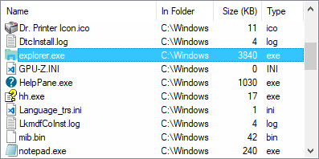

See the separate [ListView](ListView.md) page for more information.

<a id="MonthCal"></a>
## MonthCal

A tall and wide control that displays all the days of the month in calendar format. The user may select a single date or a range of dates.

Syntax:

```ahk
GuiCtrl := MyGui.Add("MonthCal", Options, Timestamp)
GuiCtrl := MyGui.AddMonthCal(Options, Timestamp)
```

Example:

```ahk
MyMC := MyGui.Add("MonthCal")
```

Appearance:

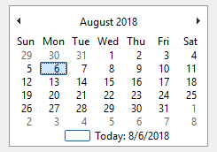

<a id="MonthCal_Parameters"></a>
### MonthCal Parameters

<a id="MonthCal_Options"></a>

**Options**

Type: [String](../Concepts.md#strings)

In addition to the [general options and styles](Gui.md#Add_Options), the following are supported or noteworthy:

<a id="MonthCalMulti"></a>

**Multi:** Multi-select. Allows the user to shift-click or click-drag to select a range of adjacent dates (the user may still select a single date too). This option may be specified explicitly or put into effect automatically by means of specifying a selection range via the *Timestamp* parameter. Once the control is created, this option cannot be changed.

**Range***MinMax*: Restricts how far back or forward in time the calendar can go. Specify for *MinMax* the minimum and maximum dates in [YYYYMMDD](FileSetTime.md#YYYYMMDD) format (with a dash between them). For example, `Range20050101-20050615` would restrict the selection to the first 5.5 months of 2005. Either the minimum or maximum may be omitted to leave the calendar unrestricted in that direction. For example, `Range20010101` would prevent a date prior to 2001 from being selected, and `Range-20091231` (leading dash) would prevent a date later than 2009 from being selected. Without the Range option, any date between the years 1601 and 9999 can be selected.

**4:** Displays week numbers (1-53) to the left of each row of days. Week numbering is determined by the operating system's user local settings. The three possible modes are described in the documentation for [LOCALE_IFIRSTWEEKOFYEAR](https://learn.microsoft.com/windows/win32/intl/locale-ifirstweekofyear).

**8:** Prevents the circling of today's date within the control.

**16:** Prevents the display of today's date at the bottom of the control.

**(Uncommon numeric styles):** See the [MonthCal styles table](../misc/Styles.md#MonthCal) for a list.

**Timestamp**

Type: [String](../Concepts.md#strings)

If blank or omitted, today's date is pre-selected. Otherwise, specify dates in [YYYYMMDD](FileSetTime.md#YYYYMMDD) format – either a single date, or a range of dates by including a dash between two dates. For example, `"20050531"` selects May 31, 2005, and `"20050525-20050531"` selects each day from May 25 through May 31, 2005.

<a id="MonthCal_Remarks"></a>
### MonthCal Remarks

It is usually best to omit width (W) and height (H) for a MonthCal because it automatically sizes itself to fit exactly one month. To display more than one month vertically, specify `R2` or higher in *Options*. To display more than one month horizontally, specify `W-2` (W negative two) or higher. These options may both be present to expand in both directions.

The today-string at the bottom of the control can be clicked to select today's date. In addition, the year and month names are clickable and allow easy selection of a new year or month.

Keyboard navigation: For supported keyboard shortcuts, see [DateTime's keyboard navigation](#DateTime_Keyboard_Navigation) (within the drop-down calendar).

When specifying dates in the [YYYYMMDD](FileSetTime.md#YYYYMMDD) format, the MM and/or DD portions may be omitted, in which case they are assumed to be 1. For example, `200205` is seen as 20020501, and `2005` is seen as 20050101.

[GuiControl.Value](GuiControl.md#Value) returns the selected date in [YYYYMMDD](FileSetTime.md#YYYYMMDD) format (without any time portion). [Gui.Submit](Gui.md#Submit) stores the same value. However, when the [multi-select](#MonthCalMulti) option is in effect, the minimum and maximum dates are retrieved with a dash between them (e.g. `20050101-20050108`). If only a single date was selected in a multi-select calendar, the minimum and maximum are both present but identical. [StrSplit](StrSplit.md) can be used to separate the dates. For example, `Date := StrSplit(MyMC.Value, "-")` would store the minimum in Date[1] and the maximum in Date[2].

Whenever the user changes the selection, the [Change](GuiOnEvent.md#Change) event is raised.

The colors of the day numbers inside the calendar obey that set by [Gui.SetFont](Gui.md#SetFont) or the [c (Color)](Gui.md#OtherOptions) option if the control has [Classic Theme appearance](Gui.md#Theme). To change the colors of other parts of the calendar, use [SendMessage](SendMessage.md) as in this example:

```ahk
MCM_SETCOLOR      := 0x100A

MCSC_BACKGROUND   := 0 ; overall background
MCSC_MONTHBK      := 4 ; the month's background
MCSC_TEXT         := 1 ; the month's text
MCSC_TITLEBK      := 2 ; the title's background
MCSC_TITLETEXT    := 3 ; the title's text
MCSC_TRAILINGTEXT := 5 ; the other months' text

TitleBackColor := 0xFFAA99 ; The title's new background color (BGR, not RGB).
TitleTextColor := 0x0066CC ; The title's new text color (BGR, not RGB).

MyGui := Gui()
MyMC := MyGui.Add("MonthCal", "-Theme")
SendMessage(MCM_SETCOLOR, MCSC_TITLEBK, TitleBackColor, MyMC)
SendMessage(MCM_SETCOLOR, MCSC_TITLETEXT, TitleTextColor, MyMC)
MyGui.Show()
```

<a id="Pic"></a>

<a id="Picture"></a>
## Picture

An area containing an image.

Syntax:

```ahk
GuiCtrl := MyGui.Add("Picture", Options, ImageFile)
GuiCtrl := MyGui.AddPicture(Options, ImageFile)
```

Example:

```ahk
MyPic := MyGui.Add("Picture", "w300 h-1", "C:\My Pictures\Company Logo.gif")
```

<a id="Picture_Parameters"></a>
### Picture Parameters

**Picture**

The control type name can be either Picture or Pic.

**Options**

Type: [String](../Concepts.md#strings)

In addition to the [general options and styles](Gui.md#Add_Options), the following are supported or noteworthy:

<a id="PicAltSubmit"></a>

**AltSubmit:** Tells the program to use Microsoft's GDIPlus.dll to load the image, which might result in a different appearance for GIF, BMP, and icon images. For example, it would load a GIF that has a transparent background as a transparent bitmap, which allows the [BackgroundTrans](Gui.md#BackgroundTrans) option to take effect (but icons support transparency without AltSubmit).

**W***n* and **H***n*: The width and height used to scale the image, where *n* is an integer (these dimensions also determine which icon to load from a multi-icon file). If one dimension is omitted or -1, it is calculated automatically based on the other dimension, preserving aspect ratio. If both are omitted, the image's original size is used. If either dimension is 0, the original size is used for that dimension. For example, specifying `w200 h-1` would make the image 200 pixels wide and cause its height to be set automatically. If the picture cannot be loaded or displayed (e.g. file not found), an error is thrown and the control is not added.

<a id="Picture_Icon"></a>

**Icon***N*: To use an icon group other than the first one in the file, specify for *N* the number of the group. For example, `Icon2` would load the default icon from the second icon group.

<a id="Picture_ImageFile"></a>

**ImageFile**

Type: [String](../Concepts.md#strings)

The name of an image or multi-icon file, which is assumed to be in [A_WorkingDir](../Variables.md#WorkingDir) if an absolute path isn't specified, or a [bitmap or icon handle](../misc/ImageHandles.md) such as `"HBITMAP:" handle`.

**Image file:** Formats supported without the use of GDIPlus include GIF, JPG, BMP, ICO, CUR, and ANI images. GDIPlus is used by default for other image formats, such as PNG, TIF, Exif, WMF and EMF.

**Multi-icon file:** Icons and cursors may be loaded from the following types of files: ICO, CUR, ANI, EXE, DLL, CPL, SCR, and other types that contain icon resources. To use an icon group other than the first one in the file, use the [Icon](#Picture_Icon) option.

<a id="Picture_Remarks"></a>
### Picture Remarks

<a id="Picture_SS_NOTIFY"></a>

Whenever the user clicks the picture, the [Click](GuiOnEvent.md#Click) event is raised. The [DoubleClick](GuiOnEvent.md#DoubleClick) event is also supported. Only Picture controls with the SS_NOTIFY (0x100) style send click and double-click notifications, so [GuiControl.OnEvent](GuiControl.md#OnEvent) automatically adds this style when a Click or DoubleClick callback is registered. The SS_NOTIFY style causes the OS to automatically copy the control's text to the clipboard when it is double-clicked.

To use a picture as a background for other controls, the picture should normally be added prior to those controls. However, if those controls are input-capable and the picture has the SS_NOTIFY style (described above), create the picture after the other controls and include 0x4000000 (which is WS_CLIPSIBLINGS) in the picture's *Options*. This trick also allows a picture to be the background behind a [Tab](#Tab) or [ListView](ListView.md) control.

Although animated GIF files can be displayed in a Picture control, they will not actually be animated. To solve this, use the [ActiveX](#ActiveX) control. For example:

```ahk
; Specify below the path to the GIF file to animate (local files are allowed too):
pic := "http://www.animatedgif.net/cartoons/A_5odie_e0.gif"
MyGui := Gui()
MyGui.Add("ActiveX", "w100 h150", "mshtml:")
MyGui.Show()
```

<a id="Progress"></a>
## Progress

A dual-color bar typically used to indicate how much progress has been made toward the completion of an operation.

Syntax:

```ahk
GuiCtrl := MyGui.Add("Progress", Options, StartPos)
GuiCtrl := MyGui.AddProgress(Options, StartPos)
```

Example:

```ahk
MyProgress := MyGui.Add("Progress", "w200 h20 cBlue", 75)
```

Appearance:

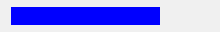

<a id="Progress_Parameters"></a>
### Progress Parameters

<a id="Progress_Options"></a>

**Options**

Type: [String](../Concepts.md#strings)

In addition to the [general options and styles](Gui.md#Add_Options), the following are supported or noteworthy:

**C***Color*: Changes the bar's color. Specify for *Color* one of the 16 primary HTML [color names](../misc/Colors.md) or a 6-digit RGB color value. Examples: `cRed`, `cFFFF33`, `cDefault`. If the C option is never used (or `cDefault` is specified), the system's default bar color will be used.

**Background***Color*: Changes the bar's background color. Specify for *Color* one of the 16 primary HTML [color names](../misc/Colors.md) or a 6-digit RGB color value. Examples: `BackgroundGreen`, `BackgroundFFFF33`, `BackgroundDefault`. If the Background option is never used (or `BackgroundDefault` is specified), the background color will be that of the window or [Tab](#Tab) control behind it.

**Range***MinMax*: Sets the range to be something other than 0 to 100. Specify for *MinMax* the minimum, a dash, and maximum. For example, `Range0-1000` would allow numbers between 0 and 1000; `Range-50-50` would allow numbers between -50 and 50; and `Range-10--5` would allow numbers between -10 and -5.

**Smooth:** Displays a simple continuous bar. If this option is not used and the bar does not have any custom colors, the bar's appearance is defined by the current system theme. Otherwise, the bar appears as a length of segments.

<a id="Progress_Vertical"></a>

**Vertical:** Makes the bar rise or fall vertically rather than move along horizontally.

**W***n*: Sets the width of the control. For example, specifying `w400` would make the control 400 pixels wide. If omitted, horizontal bars default to 15 times the current font size, while [vertical](#Progress_Vertical) bars default to 2 times the current font size.

**R***n* or **H***n*: Sets the height of the control. For example, specifying `r7` would make the control 7 rows tall, while `h400` would set its height to 400 pixels. If both R and H are omitted, horizontal bars default to 2 times the current font size, while [vertical](#Progress_Vertical) bars default to 5 rows.

**(Uncommon numeric styles):** See the [Progress styles table](../misc/Styles.md#Progress) for a list.

**StartPos**

Type: [Integer](../Concepts.md#numbers)

If blank or omitted, the bar starts off at 0 or the number in the allowable range that is closest to 0. Otherwise, specify the starting position of the bar.

<a id="Progress_Remarks"></a>
### Progress Remarks

[GuiControl.Value](GuiControl.md#Value) returns the current numeric position of the bar. [Gui.Submit](Gui.md#Submit) stores the same value.

To later change the position of the bar, follow this example:

```ahk
MyProgress.Value += 20  ; Increase the current position by 20.
MyProgress.Value := 50  ; Set the current position to 50.
```

For horizontal progress bars, the thickness of the bar is equal to the control's height. For [vertical](#Progress_Vertical) progress bars it is equal to the control's width.

<a id="Radio"></a>
## Radio

A radio button is a small empty circle that can be checked (on) or unchecked (off).

Syntax:

```ahk
GuiCtrl := MyGui.Add("Radio", Options, Caption)
GuiCtrl := MyGui.AddRadio(Options, Caption)
```

Example:

```ahk
MyRadio := MyGui.Add("Radio",, "Wait for all items to be in stock before shipping.")
```

Appearance:

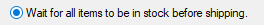

<a id="Radio_Parameters"></a>
### Radio Parameters

**Options**

Type: [String](../Concepts.md#strings)

In addition to the [general options and styles](Gui.md#Add_Options), the following are supported or noteworthy:

**Checked:** The button starts off in the "on" state. The word Checked may optionally be followed immediately by a 0 or 1 to indicate the starting state (unchecked or checked). In other words, `"Checked"` and `"Checked" VarContainingOne` are the same.

<a id="Radio_Group"></a>

**Group:** Starts a new [radio group](#Radio_Group_Details).

**(Uncommon numeric styles):** See the [Radio styles table](../misc/Styles.md#Button) for a list.

**Caption**

Type: [String](../Concepts.md#strings)

The label to display to the right of the radio button. This label is typically used as a prompt or description, and it may include linefeeds (\`n) to start new lines.

An ampersand (&) may be used to underline one of the letters, such as the letter P in `"&Pause"`. This allows the user to press `Alt`+`P` as a [shortcut key](Gui.md#ShortcutKey). To display a literal ampersand, specify two consecutive ampersands (&&).

<a id="Radio_Remarks"></a>
### Radio Remarks

<a id="Radio_Group_Details"></a>

These controls usually appear in *radio groups*, each of which contains two or more radio buttons. When the user clicks a radio button to turn it on, any others in its radio group are turned off automatically (the user may also navigate inside a group with the arrow keys). A radio group is created automatically around all consecutively added radio buttons. To start a new group, specify the [Group](#Radio_Group) option for the first button of the new group -- or simply add a non-radio control in between, since that automatically starts a new group.

[GuiControl.Value](GuiControl.md#Value) returns the number 1 for "on" and 0 for "off". To instead retrieve the index of the selected radio button within a radio group, [name](GuiControl.md#Name) only one of the radio buttons and use [Gui.Submit](Gui.md#submit-radio).

Whenever the user turns on the button, the [Click](GuiOnEvent.md#Click) event is raised. Unlike the single-variable mode in the previous paragraph, the event callback must be registered for each button in a radio group for which it should be called. This allows the flexibility to ignore the clicks of certain buttons.

The [DoubleClick](GuiOnEvent.md#DoubleClick), [Focus](GuiOnEvent.md#Focus) and [LoseFocus](GuiOnEvent.md#LoseFocus) events are also supported. As these events are only raised if the control has the BS_NOTIFY (0x4000) style, it is added automatically by [GuiControl.OnEvent](GuiControl.md#OnEvent).

If a width (W) is specified in *Options* but no [rows (R)](Gui.md#R) or height (H), the control's text will be word-wrapped as needed, and the control's height will be set automatically.

Known limitation: Certain desktop themes might not display a radio button's text properly. If this occurs, try including `-Wrap` (minus Wrap) in *Options*. However, this also prevents having more than one line of text.

<a id="Slider"></a>
## Slider

A sliding bar that the user can move along a vertical or horizontal track. The standard volume control in the taskbar's tray is an example of a slider.

Syntax:

```ahk
GuiCtrl := MyGui.Add("Slider", Options, StartPos)
GuiCtrl := MyGui.AddSlider(Options, StartPos)
```

Example:

```ahk
MySlider := MyGui.Add("Slider",, 50)
```

Appearance:

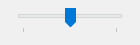

<a id="Slider_Parameters"></a>
### Slider Parameters

<a id="Slider_Options"></a>

**Options**

Type: [String](../Concepts.md#strings)

In addition to the [general options and styles](Gui.md#Add_Options), the following are supported or noteworthy:

**Buddy1***ControlID* and **Buddy2***ControlID*: Automatically repositions up to two existing controls at the ends of the slider. Buddy1 is displayed at the left or top side (depending on whether the [Vertical](#Slider_Vertical) option is present). Buddy2 is displayed at the right or bottom side. Specify for *ControlID* the [Name](GuiControl.md#Name) or [HWND](../misc/ControlID.md#HWND) of an existing control. For example, `Buddy1MyTopText` would assign the control whose explicit name is MyTopText. The [text](../misc/ControlID.md#Text) or [ClassNN](../misc/ControlID.md#ClassNN) of a control can also be used, but only up to the first space or tab.

<a id="Slider_Center"></a>

**Center:** The thumb (the bar moved by the user) will be blunt on both ends rather than pointed at one end.

**Invert:** Reverses the control so that the lower value is considered to be on the right/bottom rather than the left/top. This is typically used to make a [vertical](#Slider_Vertical) slider move in the direction of a traditional volume control. Note that the [ToolTip](#Slider_ToolTip) option will not obey the inversion and therefore should not be used in this case.

**Left:** The thumb (the bar moved by the user) will point to the top rather than the bottom. But if the [Vertical](#Slider_Vertical) option is in effect, the thumb will point to the left rather than the right.

**Line***N*: Specify for *N* the number of positions to move when the user presses `↑`, `→`, `↓`, or `←`. For example, `Line2`.

**NoTicks:** Omits tickmarks alongside the track.

**Page***N*: Specify for *N* the number of positions to move when the user presses `PgUp` or `PgDn`. For example, `Page10`.

**Range***MinMax*: Sets the range to be something other than 0 to 100. Specify for *MinMax* the minimum, a dash, and maximum. For example, `Range1-1000` would allow a number between 1 and 1000 to be selected; `Range-50-50` would allow a number between -50 and 50; and `Range-10--5` would allow a number between -10 and -5.

<a id="Slider_Thick"></a>

**Thick***N*: Specify for *N* the length of the thumb (the bar moved by the user) in pixels. For example, `Thick30`. To go beyond a certain thickness, it is probably necessary to either specify the [Center](#Slider_Center) option or remove the theme from the control (which can be done by specifying [-Theme](Gui.md#Theme)).

**TickInterval***N*: Provides tickmarks alongside the track at the specified interval. Specify for *N* the interval at which to display additional tickmarks (if the interval is never set, it defaults to 1). For example, `TickInterval10` would display a tickmark once every 10 positions.

<a id="Slider_ToolTip"></a>

**ToolTip:** Creates a [tooltip](ToolTip.md) that reports the numeric position of the slider as the user is dragging it. To have the tooltip appear in a non-default position, specify one of the following instead: `ToolTipLeft` or `ToolTipRight` (for [vertical](#Slider_Vertical) sliders); `ToolTipTop` or `ToolTipBottom` (for horizontal sliders).

<a id="Slider_Vertical"></a>

**Vertical:** Makes the control slide up and down rather than left and right.

**W***n*: Sets the width of the control. For example, specifying `w400` would make the control 400 pixels wide. If omitted, horizontal sliders default to 15 times the current font size, while [vertical](#Slider_Vertical) sliders default to 30 pixels (except if a [thickness](#Slider_Thick) has been specified).

**R***n* or **H***n*: Sets the height of the control. For example, specifying `r7` would make the control 7 rows tall, while `h400` would set its height to 400 pixels. If both R and H are omitted, horizontal sliders default to 30 pixels (except if a [thickness](#Slider_Thick) has been specified), while [vertical](#Slider_Vertical) sliders default to 5 rows.

**(Uncommon numeric styles):** See the [Slider styles table](../misc/Styles.md#Slider) for a list.

**StartPos**

Type: [Integer](../Concepts.md#numbers)

If blank or omitted, the slider starts off at 0 or the number in the allowable range that is closest to 0. Otherwise, specify the starting position of the slider.

<a id="Slider_Remarks"></a>
### Slider Remarks

[GuiControl.Value](GuiControl.md#Value) returns the current numeric position of the slider. [Gui.Submit](Gui.md#Submit) stores the same value.

<a id="slider-change"></a>

Whenever the user has stopped moving the slider (such as by releasing the mouse button after having dragged it), the [Change](GuiOnEvent.md#Change) event is raised. If the control has the [AltSubmit](Gui.md#AltSubmit) option, the Change event is also raised (very frequently) after each visible movement of the bar while the user is dragging it with the mouse. The callback receives a number indicating how the slider was moved. For details, see the [Change](GuiOnEvent.md#Change) event.

The user may slide the control by the following means: 1) dragging the bar with the mouse; 2) clicking inside the bar's track area with the mouse; 3) turning the mouse wheel while the control has focus; or 4) pressing the following keys while the control has focus: `↑`, `→`, `↓`, `←`, `PgUp`, `PgDn`, `Home`, and `End`.

<a id="StatusBar"></a>
## StatusBar

A row of text and/or icons attached to the bottom of a window, which is typically used to report changing conditions.

Syntax:

```ahk
GuiCtrl := MyGui.Add("StatusBar", Options, Text)
GuiCtrl := MyGui.AddStatusBar(Options, Text)
```

Example:

```ahk
MySB := MyGui.Add("StatusBar",, "Bar's starting text (omit to start off empty).")
MySB.SetText("There are " RowCount " rows selected.")
```

Appearance:

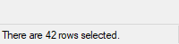

<a id="StatusBar_Parameters"></a>
### StatusBar Parameters

**Options**

Type: [String](../Concepts.md#strings)

In addition to the [general options and styles](Gui.md#Add_Options), the following are supported or noteworthy:

<a id="StatusBar_Background"></a>

**Background***Color*: Changes the control's background color. Specify for *Color* a color name (see [color chart](../misc/Colors.md)) or RGB value (the 0x prefix is optional). Examples: `BackgroundSilver`, `BackgroundFFDD99`, `BackgroundDefault`. Note that the control must have [Classic Theme appearance](Gui.md#Theme).

**(Uncommon numeric styles):** See the [StatusBar styles table](../misc/Styles.md#StatusBar) for a list.

**Text**

Type: [String](../Concepts.md#strings)

If blank or omitted, the control starts off empty. Otherwise, specify the text to appear inside the control.

<a id="StatusBar_Methods"></a>
### StatusBar Methods

In addition to the [default methods/properties of a GUI control](GuiControl.md), this control type has the following methods:

- [SetText](#SB_SetText): Displays new text in the specified part of the status bar.
- [SetParts](#SB_SetParts): Divides the bar into multiple sections according to the specified widths.
- [SetIcon](#SB_SetIcon): Displays a small icon to the left of the text in the specified part.

<a id="SB_SetText"></a>

### SetText

Displays new text in the specified part of the status bar.

```ahk
GuiCtrl.SetText(NewText , PartNumber, Style)
```

<a id="SB_SetText_Parameters"></a>
#### Parameters

**NewText**

Type: [String](../Concepts.md#strings)

Up to two tab characters (\`t) may be present anywhere in the new text: anything to the right of the first tab is centered within the part, and anything to the right of the second tab is right-justified.

**PartNumber**

Type: [Integer](../Concepts.md#numbers)

If omitted, it defaults to 1. Otherwise, specify an integer between 1 and 256.

**Style**

Type: [Integer](../Concepts.md#numbers)

If omitted, it defaults to 0, which uses a traditional border that makes that part of the bar look sunken. Otherwise, specify 1 to have no border, or 2 to have border that makes that part of the bar look raised.

<a id="SB_SetParts"></a>

### SetParts

Divides the bar into multiple sections according to the specified widths.

```ahk
GuiCtrl.SetParts(Width1, Width2, ... Width255)
```

<a id="SB_SetParts_Parameters"></a>
#### Parameters

**Width1 ... Width255**

Type: [Integer](../Concepts.md#numbers)

If all parameters are omitted, the bar is restored to having only a single, long part. Otherwise, specify the width of each part except the last (the last will fill the remaining width of the bar). For example, `MySB.SetParts(50, 50)` would create three parts: the first two of width 50, and the last one of all the remaining width. The numbers are in pixels.

<a id="SB_SetParts_Return_Value"></a>
#### Return Value

Type: [Integer](../Concepts.md#numbers)

This method returns the control's [window handle (HWND)](../misc/ControlID.md#HWND).

<a id="SB_SetParts_Remarks"></a>
#### Remarks

Any parts "deleted" by this method will start off with no text the next time they are shown. Furthermore, their icons are automatically destroyed.

<a id="SB_SetIcon"></a>

### SetIcon

Displays a small icon to the left of the text in the specified part.

```ahk
GuiCtrl.SetIcon(FileName , IconNumber, PartNumber)
```

<a id="SB_SetIcon_Parameters"></a>
#### Parameters

**FileName**

Type: [String](../Concepts.md#strings)

The name of an image or multi-icon file such as `"Shell32.dll"`, or a [bitmap or icon handle](../misc/ImageHandles.md) such as `"HICON:" handle`. For a list of supported formats, see [Picture](#Picture_ImageFile). The file is assumed to be in [A_WorkingDir](../Variables.md#WorkingDir) if an absolute path isn't specified.

**IconNumber**

Type: [Integer](../Concepts.md#numbers)

If omitted, it defaults to 1 (the first icon group). Otherwise, specify the number of the icon group to be used in the file. For example, `2` would use the default icon from the second icon group. If negative, its absolute value is assumed to be the resource ID of an icon within an executable file.

**PartNumber**

Type: [Integer](../Concepts.md#numbers)

If omitted, it defaults to 1. Otherwise, specify an integer between 1 and 256.

<a id="SB_SetIcon_Return_Value"></a>
#### Return Value

Type: [Integer](../Concepts.md#numbers)

This method returns the icon's handle (HICON). The HICON is a system resource that can be safely ignored by most scripts because it is destroyed automatically when the status bar's window is destroyed. Similarly, any old icon is destroyed when this method replaces it with a new one. This can be avoided via:

```ahk
SendMessage(0x040F, PartNumber - 1, HICON, MySB)  ; 0x040F is SB_SETICON.
```

<a id="StatusBar_Remarks"></a>
### StatusBar Remarks

The simplest use of a status bar is to call [SetText](#SB_SetText) whenever something changes that should be reported to the user. To report more than one piece of information, divide the bar into sections via [SetParts](#SB_SetParts). To display icon(s) in the bar, call [SetIcon](#SB_SetIcon).

Whenever the user clicks on the bar, the [Click](GuiOnEvent.md#Click), [DoubleClick](GuiOnEvent.md#DoubleClick), or [ContextMenu](GuiOnEvent.md#ContextMenu) event is raised, and the callback receives the part number. However, the part number might be a very large integer if the user clicks near the sizing grip at the right side of the bar.

Although the font size, face, and style can be set via [GuiControl.SetFont](GuiControl.md#SetFont) (just like normal controls), the text color cannot be changed. However, the status bar's background color may be changed by using the [Background](#StatusBar_Background) option.

Upon creation, the bar can be hidden via `MySB := MyGui.Add("StatusBar", "Hidden")`. To hide it sometime after creation, use `MySB.Visible := false`. To show it, use `MySB.Visible := true`. Note that hiding the bar does not reduce the height of the window. If that is desired, one easy way is `MyGui.Show("AutoSize")`.

Known limitations: 1) Any control that overlaps the status bar might sometimes get drawn on top of it. One way to avoid this is to dynamically shrink such controls via the [Size](GuiOnEvent.md#Size) event. 2) Positioning and sizing options are ignored. 3) There is a limit of one status bar per window.

[TreeView example #1](TreeView.md#ExAdvanced) demonstrates a multipart status bar.

<a id="Tab"></a>
## Tab

A large control containing multiple pages, each of which contains other controls. From this point forward, these pages are referred to as "tabs".

Syntax:

```ahk
GuiCtrl := MyGui.Add("Tab", Options, TabNames)
GuiCtrl := MyGui.AddTab(Options, TabNames)
```

Example:

```ahk
MyTab := MyGui.Add("Tab",, ["General", "View", "Settings"])
```

Appearance:

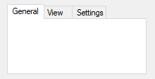

<a id="Tab_Parameters"></a>
### Tab Parameters

**Tab**

The control type name can be either Tab, Tab2, or Tab3:

**Tab:** Retained for backward compatibility because of [differences in behavior](#Tab_vs) between Tab and Tab2/Tab3.

**Tab2:** Fixes rare redrawing problems in the original "Tab" control but introduces [some other problems](#Tab2_Issues).

**Tab3:** Recommended. Fixes some issues which affect Tab and Tab2. Controls are placed within an invisible "tab dialog" which moves and resizes with the tab control. The tab control is themed by default.

<a id="Tab_Options"></a>

**Options**

Type: [String](../Concepts.md#strings)

In addition to the [general options and styles](Gui.md#Add_Options), the following are supported or noteworthy:

<a id="ChooseTab"></a>

**Choose***N*: Specify for *N* the number of a tab to be pre-selected. For example, `Choose5` would pre-select the fifth tab (as with other options, it can also be a variable such as `"Choose" Var`). To change the choice after the control has been created, use [GuiControl.Choose](GuiControl.md#Choose).

**Background:** Specify `-Background` (minus Background) to override the [window's custom background color](Gui.md#BackColor) and use the system's default Tab control color.

**Theme:** Makes the Tab control conform to the current desktop theme. However, most control types will look strange inside a Tab control because their backgrounds will not match that of the Tab control. This can be fixed for some control types (such as [Text](#Text)) by adding [BackgroundTrans](Gui.md#BackgroundTrans) to their options. Tab3 is themed by default and does not require this fix.

<a id="Tab_Buttons"></a>

**Buttons:** Creates a series of buttons at the top of the control rather than a series of tabs (in this case, there will be no border by default because the display area does not typically contain controls).

**Left**, **Right**, or **Bottom**: Specify one of these words to have the tabs on the left, right, or bottom side instead of the top. See [TCS_VERTICAL](../misc/Styles.md#TCS_VERTICAL) for limitations on Left and Right.

**Wrap:** Specify `-Wrap` (minus Wrap) to prevent the tabs from taking up more than a single row (in which case, if there are too many tabs to fit, arrow buttons are displayed to allow the user to slide more tabs into view).

**W***n*: Sets the width of the control. For example, specifying `w400` would make the control 400 pixels wide. If omitted, the default is 30 times the current font size, plus 3 times the [X-margin](Gui.md#MarginX). Tab3 with sub-controls ignores this default.

**R***n* or **H***n*: Sets the height of the control. For example, specifying `r7` would make room for 7 rows inside the control, while `h400` would set the total height of the control to 400 pixels. If both R and H are omitted, the default is 10 rows. Tab3 with sub-controls ignores this default.

**(Uncommon numeric styles):** See the [Tab styles table](../misc/Styles.md#Tab) for a list.

**TabNames**

Type: [Array](Array.md)

An array of tab names such as `["Red", "Green", "Blue"]`. To add or remove tabs after the control has been created, use [GuiControl.Add](GuiControl.md#Add) or [GuiControl.Delete](GuiControl.md#Delete).

<a id="Tab_Methods"></a>
### Tab Methods

In addition to the [default methods/properties of a GUI control](GuiControl.md), this control type has the following methods:

- [UseTab](#Tab_UseTab): Causes subsequently added controls to be owned by a tab.

<a id="Tab_UseTab"></a>

### UseTab

Causes subsequently added controls to be owned by a tab.

```ahk
GuiCtrl.UseTab(Tab, FullNameMatch)
```

<a id="Tab_UseTab_Parameters"></a>
#### Parameters

**Tab**

Type: [Integer](../Concepts.md#numbers) or [String](../Concepts.md#strings)

If blank or omitted, it defaults to 0, which causes subsequently added controls to not be part of any Tab control. Otherwise, specify 1 for the first tab, 2 for the second, etc.

If a string is specified (even a numeric string), UseTab iterates through the tab names until it finds a match. The search is not case-sensitive. Use *FullNameMatch* to change the matching behavior.

**FullNameMatch**

Type: [Boolean](../Concepts.md#boolean)

If omitted, it defaults to false.

If **false**, the tab whose name starts with the string will be used. For example, if the control contains the tab "UNIX Text", specifying the word unix (lowercase) would be enough to use it.

If **true**, the tab whose name fully matches the string will be used.

<a id="Tab_Remarks"></a>
### Tab Remarks

<a id="UseTab_Usage"></a>

After creating a Tab control, subsequently added controls automatically belong to its first tab. This can be changed at any time by using [UseTab](#Tab_UseTab) as follows:

```ahk
MyTab.UseTab()  ; Future controls are not part of any Tab control.
MyTab.UseTab(3)  ; Future controls are owned by the third tab of the current Tab control.
MyTab2.UseTab(3)  ; Future controls are owned by the third tab of the second Tab control.
MyTab.UseTab("Name")  ; Future controls are owned by the tab whose name starts with Name (not case-sensitive).
MyTab.UseTab("Name", true)  ; Same as above but requires exact match (not case-sensitive).
```

It is also possible to use any of the examples above to assign controls to a tab or tab-control that does not yet exist (except in the case of the *Name* method). But in that case, the relative positioning options described below are not supported.

When each tab of a Tab control receives its first sub-control, that sub-control will have a special default position under the following conditions: 1) The X and Y coordinates are both omitted, in which case the first sub-control is positioned at the upper-left corner of the Tab control's interior (with a standard [X-margin](Gui.md#MarginX) and [Y-margin](Gui.md#MarginY)), and sub-controls beyond the first are positioned beneath the previous control; 2) The [X+n and/or Y+n](Gui.md#PosPlus) positioning options are specified, in which case the sub-control is positioned relative to the upper-left corner of the Tab control's interior. For example, specifying `x+10 y+10` would position the control 10 pixels right and 10 pixels down from the upper left corner.

[GuiControl.Value](GuiControl.md#Value) returns the index of the currently selected tab (the first tab is 1, the second is 2, etc.) or 0 if there is no tab selected, while [GuiControl.Text](GuiControl.md#Text) returns the text of the currently selected tab. [Gui.Submit](Gui.md#Submit) stores the text, unless the control has the [AltSubmit](Gui.md#AltSubmit) option, in which case it stores the index of the tab.

Whenever the user changes to a new tab, the [Change](GuiOnEvent.md#Change) event is raised.

Keyboard navigation: The user may press `Ctrl`+`PgDn`/`PgUp` to navigate from tab to tab in a Tab control; if the keyboard focus is on a control that does not belong to a Tab control, the window's first Tab control will be navigated. `Ctrl`+`Tab` and `Ctrl`+`Shift`+`Tab` may also be used, except that they will not work if the currently focused control is a multi-line Edit control.

Each window may have no more than 255 Tab controls. Each Tab control may have no more than 256 tabs. In addition, a Tab control may not contain other Tab controls.

<a id="Tab_vs"></a>
### Tab vs. Tab2 vs. Tab3

> **Note:** "Tab control" is a general term for all three types (Tab, Tab2, and Tab3). Whenever this section refers specifically to the original "Tab" control, it is labeled "Tab1" to avoid confusion.

<a id="Tab_Parent"></a>

**Parent window:** The parent window of a control affects the positioning and visibility of the control and tab-key navigation order. If a sub-control is added to an existing Tab3 control, its parent window is the "tab dialog", which fills the Tab3 control's display area. Most other controls, including sub-controls of Tab1 or Tab2 controls, have no parent other than the GUI window itself.

<a id="Tab_Positioning"></a>

**Positioning:** For Tab1 and Tab2, sub-controls do not necessarily need to exist within their Tab control's boundaries: They will still be hidden and shown whenever their tab is selected or de-selected. This behavior is especially appropriate for the [Buttons](#Tab_Buttons) option.

For Tab3, sub-controls assigned to a tab *before* the Tab3 control is created behave as though added to a Tab1 or Tab2 control. All other sub-controls are visible only within the display area of the Tab3 control.

If a Tab3 control is moved, its sub-controls are moved with it. Tab1 and Tab2 controls do not have this behavior.

In the rare case that [WinMove](WinMove.md) (or an equivalent DllCall) is used to move a control, the coordinates must be relative to the parent window of the control, which might not be the GUI (see [above](#Tab_Parent)). By contrast, [GuiControl.Move](GuiControl.md#Move) takes GUI coordinates and [ControlMove](ControlMove.md) takes window coordinates, regardless of the control's parent window.

<a id="Tab_Autosize"></a>

**Autosizing:** If not specified by the script, the width and/or height of the Tab3 control are automatically calculated at one of the following times (whichever comes first after the control is created):

- The first time the Tab3 control ceases to be the current Tab control. This can occur as a result of calling [UseTab](#Tab_UseTab) (with or without parameters) or creating another Tab control.
- The first time [Gui.Show](Gui.md#Show) is called for that particular Gui.

The calculated size accounts for sub-controls which exist when autosizing occurs, plus the default margins. The size is calculated only once, and will not be recalculated even if controls are added later. If the Tab3 control is empty, it receives the same default size as a Tab1 or Tab2 control.

Tab1 and Tab2 controls are not autosized; they receive an arbitrary default size.

<a id="Tab_TabOrder"></a>

**Tab-key navigation order:** The navigation order via `Tab` usually depends on the order in which the controls are created. When Tab controls are used, the order also depends on the type of Tab control:

- Tab1 and Tab2 allow their sub-controls to be mixed with other controls within the tab-key order.
- Tab2 puts its tab buttons after its sub-controls in the tab-key order.
- Tab3 groups its sub-controls within the tab-key order and puts them after its tab buttons.

<a id="Tab_Notifs"></a>

**Notification messages (Tab3):** Common and [Custom](#Custom) controls typically send notification messages to their [parent window](#Tab_Parent). Any WM_COMMAND, WM_NOTIFY, WM_VSCROLL, WM_HSCROLL, or WM_CTLCOLOR' messages received by a Tab3 control's [tab dialog](#Tab_Parent) are forwarded to the GUI window and can be detected by using [OnMessage](OnMessage.md). If the Tab3 control is themed and the sub-control lacks the [BackgroundTrans](Gui.md#BackgroundTrans) option, WM_CTLCOLORSTATIC is fully handled by the tab dialog and not forwarded. Other notification messages (such as custom messages) are not supported.

<a id="Tab2_Issues"></a>

**Known issues with Tab2:**

- [BackgroundTrans](Gui.md#BackgroundTrans) has no effect inside a Tab2 control.
- [WebBrowser](#ActiveX) controls do not redraw correctly.
- AnimateWindow and possibly other Win32 API calls can cause the tab's controls to disappear.

<a id="Tab1_Issues"></a>

**Known issues with Tab1:**

- Activating a GUI window by clicking certain parts of its controls, such as scrollbars, might redraw improperly.
- [BackgroundTrans](Gui.md#BackgroundTrans) has no effect if the Tab1 control contains a ListView.
- [WebBrowser](#ActiveX) controls are invisible.

<a id="Text"></a>
## Text

A region containing borderless text that the user cannot edit. Often used to label other controls.

Syntax:

```ahk
GuiCtrl := MyGui.Add("Text", Options, String)
GuiCtrl := MyGui.AddText(Options, String)
```

Example:

```ahk
MyText := MyGui.Add("Text",, "Please enter your name:")
```

Appearance:

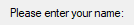

<a id="Text_Parameters"></a>
### Text Parameters

**Options**

Type: [String](../Concepts.md#strings)

In addition to the [general options and styles](Gui.md#Add_Options), the following are supported or noteworthy:

**(Uncommon numeric styles):** See the [Text styles table](../misc/Styles.md#Text) for a list.

**String**

Type: [String](../Concepts.md#strings)

The string to display, which may include linefeeds (\`n) to start new lines. In addition, a single long line can be broken up into several shorter ones by means of a [continuation section](../Scripts.md#continuation).

An ampersand (&) may be used to underline one of the letters, such as the letter F in `"&First Name"`. This allows the user to press the [shortcut key](Gui.md#ShortcutKey) `Alt`+`F` to set keyboard focus to the first input-capable control that was added after the Text control. To display a literal ampersand, specify two consecutive ampersands (&&). To disable all special treatment of ampersands, include [0x80](../misc/Styles.md#SS_NOPREFIX) in *Options*.

<a id="Text_Remarks"></a>
### Text Remarks

<a id="Text_SS_NOTIFY"></a>

Whenever the user clicks the text, the [Click](GuiOnEvent.md#Click) event is raised. The [DoubleClick](GuiOnEvent.md#DoubleClick) event is also supported. Only Text controls with the SS_NOTIFY (0x100) style send click and double-click notifications, so [GuiControl.OnEvent](GuiControl.md#OnEvent) automatically adds this style when a Click or DoubleClick callback is registered. The SS_NOTIFY style causes the OS to automatically copy the control's text to the clipboard when it is double-clicked.

If a width (W) is specified in *Options* but no [rows (R)](Gui.md#R) or height (H), the control's text will be word-wrapped as needed, and the control's height will be set automatically.

<a id="TreeView"></a>
## TreeView

A TreeView displays a hierarchy of items by indenting child items beneath their parents. The most common example is Explorer's tree of drives and folders.

Syntax:

```ahk
GuiCtrl := MyGui.Add("TreeView", Options)
GuiCtrl := MyGui.AddTreeView(Options)
```

Example:

```ahk
MyTV := MyGui.Add("TreeView", "r10")
```

Appearance:

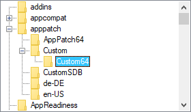

See the separate [TreeView](TreeView.md) page for more information.

<a id="UpDown"></a>
## UpDown

A pair of arrow buttons that the user can click to increase or decrease a value. By default, an UpDown control automatically snaps onto the previously added control, which is known as the UpDown's *buddy control*.

Syntax:

```ahk
GuiCtrl := MyGui.Add("UpDown", Options, StartPos)
GuiCtrl := MyGui.AddUpDown(Options, StartPos)
```

Example:

```ahk
MyGui.Add("Edit")
MyUD := MyGui.Add("UpDown", "Range1-10", 5)
```

Appearance:

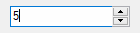

<a id="UpDown_Parameters"></a>
### UpDown Parameters

<a id="UpDown_Options"></a>

**Options**

Type: [String](../Concepts.md#strings)

In addition to the [general options and styles](Gui.md#Add_Options), the following are supported or noteworthy:

<a id="Horz"></a>

**Horz:** Makes the control's buttons point left/right rather than up/down. By default, Horz also makes the control isolated (no buddy). This can be overridden by specifying `Horz 16`.

**Left:** Puts the UpDown on the left side of its buddy rather than the right.

**Range***MinMax*: Sets the range to be something other than 0 to 100. Specify for *MinMax* the minimum, a dash, and maximum. For example, `Range1-1000` would allow a number between 1 and 1000 to be selected; `Range-50-50` would allow a number between -50 and 50; and `Range-10--5` would allow a number between -10 and -5. The minimum and maximum may be swapped to cause the arrows to move in the opposite of their normal direction. The broadest allowable range is -2147483648-2147483647. Finally, if the buddy control is a [ListBox](#ListBox), the range defaults to 32767-0 for verticals and the inverse for [horizontals](#Horz).

**Wrap:** Causes the control to wrap around to the other end of its range when the user attempts to go beyond the minimum or maximum. If omitted, the control stops when the minimum or maximum is reached.

**16:** Specify -16 (minus 16) to cause a vertical UpDown to be isolated; that is, it will have no buddy. This also causes the control to obey any specified width, height, and position rather than conforming to the size of its buddy control. In addition, an isolated UpDown tracks its own position internally. This position can be retrieved normally by means such as [GuiControl.Value](GuiControl.md#Value).

<a id="UpDownSep"></a>

**0x80:** Omits the thousands separator that is normally present between every three decimal digits in the buddy control. However, this style is normally not used because the separators are omitted from the number whenever the script retrieves it from the UpDown control itself (rather than its buddy control).

**W***n*: Sets the width of an isolated UpDown. For example, specifying `w400` would make the control 400 pixels wide. If omitted, vertical UpDowns default to 2 times the current font size, while [horizontal](#Horz) UpDowns default to 15 times the current font size.

**R***n* or **H***n*: Sets the height of an isolated UpDown. For example, specifying `r7` would make the control 7 rows tall, while `h400` would set its height to 400 pixels. If both R and H are omitted, vertical UpDowns default to 5 rows, while [horizontal](#Horz) UpDowns default to 2 times the current font size.

**(Uncommon numeric styles):** See the [UpDown styles table](../misc/Styles.md#UpDown) for a list.

**StartPos**

Type: [Integer](../Concepts.md#numbers)

If blank or omitted, the UpDown starts off at 0 or the number in the allowable range that is closest to 0. Otherwise, specify the UpDown's starting position.

<a id="UpDown_Remarks"></a>
### UpDown Remarks

The most common example is a "spinner", which is an UpDown attached to an [Edit](#Edit) control. Whenever the user presses one of the arrow buttons, the number in the Edit control is automatically increased or decreased.

An UpDown's buddy control can also be a [Text](#Text) or [ListBox](#ListBox) control. However, due to OS limitations, controls other than these (such as [ComboBox](#ComboBox) and [DropDownList](#DropDownList)) might not work properly with the [Change](GuiOnEvent.md#Change) event and other features.

[GuiControl.Value](GuiControl.md#Value) returns the current numeric position of the UpDown. [Gui.Submit](Gui.md#Submit) stores the same value. If the UpDown is attached to an [Edit](#Edit) control, and you do not wish to validate the user's input, it is best to use the UpDown's value rather than the Edit's. This is because the UpDown will always yield an in-range number, even when the user has typed something non-numeric or out-of-range in the Edit control. On a related note, numbers with more than three digits get a [thousands separator](../misc/Styles.md#UpDownSep) (such as a comma) by default. These separators are returned by the Edit control but not by the UpDown control.

Whenever the user clicks one of the arrow buttons or presses an arrow key on the keyboard, the [Change](GuiOnEvent.md#Change) event is raised.

To change an UpDown's increment to a value other than 1 (such as 5 or 0.1), see [this script](../scripts/index.md#Custom_Increments_for_UpDown_Controls).

The number format displayed inside the buddy control may be changed from decimal to hexadecimal by following this example:

```ahk
SendMessage 0x046D, 16, 0, MyUD ; 0x046D is UDM_SETBASE.
```

However, this affects only the buddy control, not the UpDown's reported position.

<a id="Related"></a>
## Related

[ListView](ListView.md), [TreeView](TreeView.md), [Gui()](Gui.md#Call), [Gui object](Gui.md), [GuiControl object](GuiControl.md), [Menu object](Menu.md)
