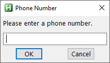

# InputBox

Displays an input box to ask the user to enter a string.

```ahk
InputBoxObj := InputBox(Prompt, Title, Options, Default)
```

<a id="Parameters"></a>
## Parameters

**Prompt**

Type: [String](../Concepts.md#strings)

If blank or omitted, it defaults to no text. Otherwise, specify the text, which is usually a message to the user indicating what kind of input is expected. If *Prompt* is long, it can be broken up into several shorter lines by means of a [continuation section](../Scripts.md#continuation), which might improve readability and maintainability.

**Title**

Type: [String](../Concepts.md#strings)

If omitted, it defaults to the current value of [A_ScriptName](../Variables.md#ScriptName). Otherwise, specify the title of the input box.

**Options**

Type: [String](../Concepts.md#strings)

If blank or omitted, the input box will be centered horizontally and vertically on the screen, with a default size of about 380x200 pixels, depending on the OS version and theme. Otherwise, specify a string of one or more of the following options, each separated from the next with a space or tab:

**X***n* and **Y***n*: The X and Y coordinates of the dialog. For example, `x0 y0` puts the window at the upper left corner of the desktop. If either coordinate is omitted, the dialog will be centered in that dimension. Either coordinate can be negative to position the dialog partially or entirely off the desktop (or on a secondary monitor in a multi-monitor setup).

**W***n* and **H***n*: The width and height of the dialog's client area, which excludes the title bar and borders. For example, `w200 h100`.

**T***n*: Specifies the timeout in seconds. For example, `T10.0` is ten seconds. If this value exceeds 2147483 (24.8 days), it will be set to 2147483. After the timeout has elapsed, the input box will be automatically closed and [InputBoxObj.Result](#return) will be set to the word Timeout. [InputBoxObj.Value](#return) will still contain what the user entered.

**Password:** Hides the user's input (such as for password entry) by substituting masking characters for what the user types. If a non-default masking character is desired, include it immediately after the word Password. For example, `Password*` would make the masking character an asterisk rather than the black circle (bullet).

**Default**

Type: [String](../Concepts.md#strings)

If blank or omitted, it defaults to no string. Otherwise, specify a string that will appear in the input box's edit field when the dialog first appears. The user can change it by backspacing or other means.

<a id="return"></a>
## Return Value

Type: [Object](../Concepts.md#objects)

This function returns an object with the following properties:

- `Value` ([String](../Concepts.md#strings)): The text entered by the user.
- `Result` ([String](../Concepts.md#strings)): One of the following words indicating how the input box was closed: OK, Cancel, or Timeout.

<a id="Remarks"></a>
## Remarks

An input box usually looks like this:



The dialog allows the user to enter text and then press OK or CANCEL. The user can resize the dialog window by dragging its borders.

A GUI window may display a modal input box by means of [OwnDialogs option](Gui.md#OwnDialogs). A modal input box prevents the user from interacting with the GUI window until the input box is dismissed.

<a id="Related"></a>
## Related

[Gui object](Gui.md), [MsgBox](MsgBox.md), [FileSelect](FileSelect.md), [DirSelect](DirSelect.md), [ToolTip](ToolTip.md), [InputHook](InputHook.md)

<a id="Examples"></a>
## Examples

<a id="ExPassword"></a>

**Example:** Allows the user to enter a hidden password.

```ahk
password := InputBox("(your input will be hidden)", "Enter Password", "password").value
```

<a id="ExBasic"></a>

**Example:** Allows the user to enter a phone number.

```ahk
IB := InputBox("Please enter a phone number.", "Phone Number", "w640 h480")
if IB.Result = "Cancel"
    MsgBox "You entered '" IB.Value "' but then cancelled."
else
    MsgBox "You entered '" IB.Value "'."
```
