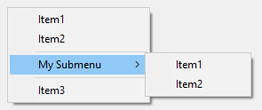

# Menu/MenuBar Object

Provides an interface to create and modify a menu or menu bar, add and modify menu items, and retrieve information about the menu or menu bar.

```ahk
class Menu extends Object
```

Menu objects are used to define, modify and display popup menus. [Menu()](#Call), [MenuFromHandle](MenuFromHandle.md) and [A_TrayMenu](../Variables.md#TrayMenu) return an object of this type.

```ahk
class MenuBar extends Menu
```

MenuBar objects are used to define and modify menu bars for use with [Gui.MenuBar](Gui.md#MenuBar). They are created with [MenuBar()](#Call). [MenuFromHandle](MenuFromHandle.md) returns an object of this type if given a menu bar handle.

"MyMenu" is used below as a placeholder for any Menu object, as "Menu" is the class itself.

In addition to the methods and properties inherited from [Object](Object.md), Menu objects have the following predefined methods and properties.

<a id="toc"></a>
## Table of Contents

- [Static Methods](#StaticMethods):
    - [Call](#Call): Creates a new Menu or MenuBar object.
- [Methods](#Methods):
    - [Add](#Add): Adds or modifies a menu item.
    - [AddStandard](#AddStandard): Adds the standard tray menu items.
    - [Check](#Check): Adds a visible checkmark next to a menu item.
    - [Delete](#Delete): Deletes one or all menu items.
    - [Disable](#Disable): Grays out a menu item to indicate that the user cannot select it.
    - [Enable](#Enable): Allows the user to once again select a menu item if it was previously disabled (grayed out).
    - [Insert](#Insert): Inserts a new item before the specified item.
    - [Rename](#Rename): Renames a menu item.
    - [SetColor](#SetColor): Changes the background color of the menu.
    - [SetIcon](#SetIcon): Sets the icon to be displayed next to a menu item.
    - [Show](#Show): Displays the menu.
    - [ToggleCheck](#ToggleCheck): Toggles the checkmark next to a menu item.
    - [ToggleEnable](#ToggleEnable): Enables or disables a menu item.
    - [Uncheck](#Uncheck): Removes the checkmark (if there is one) from a menu item.
- [Properties](#Properties):
    - [ClickCount](#ClickCount): Gets or sets how many times the tray icon must be clicked to select its default menu item.
    - [Default](#Default): Gets or sets the default menu item.
    - [Handle](#Handle): Gets the menu's Win32 handle.
- General:
    - [MenuItemName](#MenuItemName)
    - [Win32 Menus](#Win32_Menus)
    - [Remarks](#Remarks)
    - [Related](#Related)
    - [Examples](#Examples)

<a id="StaticMethods"></a>
## Static Methods

<a id="Call"></a>

### Call

Creates a new Menu or MenuBar object.

```ahk
MyMenu := Menu()
MyMenuBar := MenuBar()
MyMenu := Menu.Call()
MyMenuBar := MenuBar.Call()
```

<a id="Methods"></a>
## Methods

<a id="Add"></a>

### Add

Adds or modifies a menu item.

```ahk
MyMenu.Add(MenuItemName, CallbackOrSubmenu, Options)
```

<a id="Add_Parameters"></a>
#### Parameters

**MenuItemName**

Type: [String](../Concepts.md#strings)

The text to display on the menu item, or the position of an existing item to modify. See [MenuItemName](#MenuItemName).

<a id="CallbackOrSubmenu"></a>

**CallbackOrSubmenu**

Type: [Function Object](../misc/Functor.md) or **Menu**

The function to call as a new [thread](../misc/Threads.md) when the menu item is selected, or a reference to a Menu object to use as a submenu.

This parameter is required when creating a new item, but optional when updating the options of an existing item.

The callback accepts three parameters and can be [defined](../Functions.md#intro) as follows:

```ahk
MyCallback(ItemName, ItemPos, MyMenu) { ...
```

Although the names you give the parameters do not matter, the following values are sequentially assigned to them:

1. The name of the menu item.
2. The position number of the menu item.
3. The Menu object of the menu to which the menu item was added.

You can omit one or more parameters from the end of the callback's parameter list if the corresponding information is not needed, but in this case an asterisk must be specified as the final parameter, e.g. `MyCallback(Param1, *)`.

<a id="Options"></a>

**Options**

Type: [String](../Concepts.md#strings)

If blank or omitted, it defaults to no options. Otherwise, specify one or more options from the list below (not case-sensitive). Separate each option from the next with a space or tab. To remove an option, precede it with a minus sign. To add an option, a plus sign is permitted but not required.

**P***n*: Specify for *n* the menu item's [thread priority](../misc/Threads.md), e.g. `P1`. If this option is omitted when adding a menu item, the priority will be 0, which is the standard default. If omitted when updating a menu item, the item's priority will not be changed. Use a decimal (not hexadecimal) number as the priority.

**Radio:** If the item is checked, a bullet point is used instead of a check mark.

**Right:** The item is right-justified within the menu bar. This only applies to [menu bars](Gui.md#MenuBar), not popup menus or submenus.

**Break:** The item begins a new column in a popup menu.

**BarBreak:** As above, but with a dividing line between columns.

To change an existing item's options without affecting its callback or submenu, simply omit the *CallbackOrSubmenu* parameter.

<a id="Add_Remarks"></a>
#### Remarks

This is a multipurpose method that adds a menu item, updates one with a new submenu or callback, or converts one from a normal item into a submenu (or vice versa). If *MenuItemName* does not yet exist, it will be added to the menu. Otherwise, *MenuItemName* is updated with the newly specified *CallbackOrSubmenu* and/or *Options*.

To add a menu separator line, omit all three parameters.

This method always adds new menu items at the bottom of the menu, while the [Insert](#Insert) method can be used to insert an item before an existing custom menu item.

<a id="AddStandard"></a>

### AddStandard

Adds the standard [tray menu items](../Program.md#tray-icon).

```ahk
MyMenu.AddStandard()
```

This method can be used with the tray menu or any other menu.

The standard items are inserted after any existing items. Any standard items already in the menu are not duplicated, but any missing items are added. The table below shows the names and positions of the standard items after calling AddStandard on an empty menu:

| &Open | 1 | 0 |
| --- | --- | --- |
| &Help | 2 |  |
| --- | 3 |  |
| &Window Spy | 4 |  |
| &Reload Script | 5 |  |
| &Edit Script | 6 |  |
| --- | 7 |  |
| &Suspend Hotkeys | 8 | 1 |
| &Pause Script | 9 | 2 |
| E&xit | 10 | 3 |

Compiled scripts include only the last three by default. `&Open` is included only if [A_AllowMainWindow](../Variables.md#AllowMainWindow) is 1 when AddStandard is called (in that case, add 1 to the positions shown in the third column). If the tray menu contains standard items, `&Open` is inserted or removed whenever [A_AllowMainWindow](../Variables.md#AllowMainWindow) is changed. For other menus, `&Open` has no effect if [A_AllowMainWindow](../Variables.md#AllowMainWindow) is 0.

Each standard item has an internal menu item ID corresponding to the function it performs, but can otherwise be modified or deleted like any other menu item. AddStandard detects existing items by ID, not by name. If the [Add](#Add) method is used to change the callback function associated with a standard menu item, it is assigned a new unique ID and is no longer considered to be a standard item.

Adding the `&Open` item to the tray menu causes it to become the default item if there wasn't one already.

<a id="Check"></a>

### Check

Adds a visible checkmark in the menu next to a menu item (if there isn't one already).

```ahk
MyMenu.Check(MenuItemName)
```

<a id="Check_Parameters"></a>
#### Parameters

**MenuItemName**

Type: [String](../Concepts.md#strings)

The name or position of a menu item. See [MenuItemName](#MenuItemName).

<a id="Delete"></a>

### Delete

Deletes one or all menu items.

```ahk
MyMenu.Delete(MenuItemName)
```

<a id="Delete_Parameters"></a>
#### Parameters

**MenuItemName**

Type: [String](../Concepts.md#strings)

If omitted, all menu items are deleted from the menu, leaving the menu empty. Otherwise, specify the name or position of a menu item. See [MenuItemName](#MenuItemName).

<a id="Delete_Remarks"></a>
#### Remarks

An empty menu still exists and thus any other menus that use it as a submenu will retain those submenus.

To delete a separator line, identify it by its position in the menu. For example, use `MyMenu.Delete("3&")` if there are two items preceding the separator.

If the *default* menu item is deleted, the effect will be similar to having set `MyMenu.Default := ""`.

<a id="Disable"></a>

### Disable

Grays out a menu item to indicate that the user cannot select it.

```ahk
MyMenu.Disable(MenuItemName)
```

<a id="Disable_Parameters"></a>
#### Parameters

**MenuItemName**

Type: [String](../Concepts.md#strings)

The name or position of a menu item. See [MenuItemName](#MenuItemName).

<a id="Enable"></a>

### Enable

Allows the user to once again select a menu item if it was previously disabled (grayed out).

```ahk
MyMenu.Enable(MenuItemName)
```

<a id="Enable_Parameters"></a>
#### Parameters

**MenuItemName**

Type: [String](../Concepts.md#strings)

The name or position of a menu item. See [MenuItemName](#MenuItemName).

<a id="Insert"></a>

### Insert

Inserts a new item before the specified item.

```ahk
MyMenu.Insert(MenuItemName, ItemToInsert, CallbackOrSubmenu, Options)
```

<a id="Insert_Parameters"></a>
#### Parameters

**MenuItemName**

Type: [String](../Concepts.md#strings)

If blank or omitted, *ItemToInsert* will be added at the bottom of the menu. Otherwise, specify the name or position of an existing custom menu item before which *ItemToInsert* should be inserted. See [MenuItemName](#MenuItemName).

**ItemToInsert**

Type: [String](../Concepts.md#strings)

The name of a new menu item to insert before *MenuItemName*. Unlike the [Add](#Add) method, a new item is always created, even if *ItemToInsert* matches the name of an existing item.

**CallbackOrSubmenu**

See the Add method's [CallbackOrSubmenu parameter](#CallbackOrSubmenu).

**Options**

See the Add method's [Options parameter](#Options).

<a id="Insert_Remarks"></a>
#### Remarks

To insert a menu separator line before an existing custom menu item, omit all parameters except *MenuItemName*. To add a menu separator line at the bottom of the menu, omit all parameters.

<a id="Rename"></a>

### Rename

Renames a menu item.

```ahk
MyMenu.Rename(MenuItemName , NewName)
```

<a id="Rename_Parameters"></a>
#### Parameters

**MenuItemName**

Type: [String](../Concepts.md#strings)

The name or position of a menu item. See [MenuItemName](#MenuItemName).

**NewName**

Type: [String](../Concepts.md#strings)

If blank or omitted, *MenuItemName* will be converted into a separator line. Otherwise, specify the new name.

<a id="Rename_Remarks"></a>
#### Remarks

The menu item's current callback or submenu is unchanged.

A separator line can be converted to a normal item by specifying the position of the separator such as `"1&"` for *MenuItemName* and a non-blank name for *NewName*, and then using the [Add](#Add) method to give the item a callback or submenu.

<a id="SetColor"></a>

### SetColor

Changes the background color of the menu.

```ahk
MyMenu.SetColor(ColorValue, ApplyToSubmenus)
```

<a id="SetColor_Parameters"></a>
#### Parameters

**ColorValue**

Type: [String](../Concepts.md#strings) or [Integer](../Concepts.md#numbers)

If blank or omitted, it defaults to the word Default, which restores the default color of the menu. Otherwise, specify one of the 16 primary [HTML color names](../misc/Colors.md), a hexadecimal RGB color string (the 0x prefix is optional), or a pure numeric RGB color value. Example values: `"Silver"`, `"FFFFAA"`, `0xFFFFAA`, `"Default"`.

**ApplyToSubmenus**

Type: [Boolean](../Concepts.md#boolean)

If omitted, it defaults to true.

If **true**, the color will be applied to all of the menu's submenus.

If **false**, the color will be applied to the menu only.

<a id="SetIcon"></a>

### SetIcon

Sets the icon to be displayed next to a menu item.

```ahk
MyMenu.SetIcon(MenuItemName, FileName , IconNumber, IconWidth)
```

<a id="SetIcon_Parameters"></a>
#### Parameters

**MenuItemName**

Type: [String](../Concepts.md#strings)

The name or position of a menu item. See [MenuItemName](#MenuItemName).

**FileName**

Type: [String](../Concepts.md#strings)

The path to an icon or image file, or a [bitmap or icon handle](../misc/ImageHandles.md) such as `"HICON:" handle`. For a list of supported formats, see [Picture](GuiControls.md#Picture_ImageFile).

Specify an empty string or `"*"` to remove the item's current icon.

**IconNumber**

Type: [Integer](../Concepts.md#numbers)

If omitted, it defaults to 1 (the first icon group). Otherwise, specify the number of the icon group to be used in the file. For example, `MyMenu.SetIcon(MenuItemName, "Shell32.dll", 2)` would use the default icon from the second icon group. If negative, its absolute value is assumed to be the resource ID of an icon within an executable file.

**IconWidth**

Type: [Integer](../Concepts.md#numbers)

If omitted, it defaults to the width of a small icon recommended by the OS (usually 16 pixels). If 0, the original width is used. Otherwise, specify the desired width of the icon, in pixels. If the icon group indicated by *IconNumber* contains multiple icon sizes, the closest match is used and the icon is scaled to the specified size.

<a id="SetIcon_Remarks"></a>
#### Remarks

Currently it is necessary to specify the "actual size" when setting the icon to preserve transparency, e.g. `MyMenu.SetIcon(MenuItemName, "Filename.png",, 0)`.

<a id="Show"></a>

### Show

Displays the menu.

```ahk
MyMenu.Show(X, Y)
```

<a id="Show_Parameters"></a>
#### Parameters

**X, Y**

Type: [Integer](../Concepts.md#numbers)

If omitted, the menu will be shown near the mouse cursor. Otherwise, specify the X and Y coordinates at which to display the upper left corner of the menu. The coordinates are relative to the active window's client area unless overridden by using [CoordMode](CoordMode.md) or [A_CoordModeMenu](../Variables.md#CoordMode).

<a id="Show_Remarks"></a>
#### Remarks

Displaying the menu allows the user to select an item with arrow keys, menu shortcuts (underlined letters), or the mouse.

Any popup menu can be shown, including submenus and the tray menu. However, an exception is thrown if *MyMenu* is a MenuBar object.

<a id="ToggleCheck"></a>

### ToggleCheck

Adds a checkmark if there wasn't one; otherwise, removes it.

```ahk
MyMenu.ToggleCheck(MenuItemName)
```

<a id="ToggleCheck_Parameters"></a>
#### Parameters

**MenuItemName**

Type: [String](../Concepts.md#strings)

The name or position of a menu item. See [MenuItemName](#MenuItemName).

<a id="ToggleEnable"></a>

### ToggleEnable

Disables a menu item if it was previously enabled; otherwise, enables it.

```ahk
MyMenu.ToggleEnable(MenuItemName)
```

<a id="ToggleEnable_Parameters"></a>
#### Parameters

**MenuItemName**

Type: [String](../Concepts.md#strings)

The name or position of a menu item. See [MenuItemName](#MenuItemName).

<a id="Uncheck"></a>

### Uncheck

Removes the checkmark (if there is one) from a menu item.

```ahk
MyMenu.Uncheck(MenuItemName)
```

<a id="Uncheck_Parameters"></a>
#### Parameters

**MenuItemName**

Type: [String](../Concepts.md#strings)

The name or position of a menu item. See [MenuItemName](#MenuItemName).

<a id="Properties"></a>
## Properties

<a id="ClickCount"></a>

### ClickCount

Gets or sets how many times the [tray icon](../Program.md#tray-icon) must be clicked to select its default menu item.

```ahk
CurrentCount := MyMenu.ClickCount
```

```ahk
MyMenu.ClickCount := NewCount
```

*CurrentCount* is *NewCount* if assigned, otherwise 2 by default.

*NewCount* can be 1 to allow a single-click to select the tray menu's default menu item, or 2 to return to the default behavior (double-click). Any other value is invalid and throws an exception.

<a id="Default"></a>

### Default

Gets or sets the default menu item.

```ahk
CurrentDefault := MyMenu.Default
```

```ahk
MyMenu.Default := MenuItemName
```

*CurrentDefault* is the name of the default menu item, or an empty string if there is no default.

*MenuItemName* is the name or position of a menu item. See [MenuItemName](#MenuItemName). If *MenuItemName* is an empty string, there will be no default.

Setting the default item makes that item's font bold (setting a default item in menus other than the tray menu is currently purely cosmetic). When the user double-clicks the [tray icon](../Program.md#tray-icon), its default menu item is selected (even if the item is disabled). If there is no default, double-clicking has no effect.

The default item for the tray menu is initially `&Open`, if present. Adding `&Open` to the tray menu by calling [AddStandard](#AddStandard) or changing [A_AllowMainWindow](../Variables.md#AllowMainWindow) also causes it to become the default item if there wasn't one already.

If the default item is deleted, the menu is left without one.

<a id="Handle"></a>

### Handle

Gets a handle to a [Win32 menu](#Win32_Menus) (a handle of type `HMENU`), constructing it if necessary.

```ahk
Handle := MyMenu.Handle
```

The returned handle is valid only until the Win32 menu is destroyed, which typically occurs when the Menu object is freed. Once the menu is destroyed, the operating system may reassign the handle value to any menus subsequently created by the script or any other program.

<a id="MenuItemName"></a>
## MenuItemName

The name or position of a menu item. Some common rules apply to this parameter across all methods which use it:

To underline one of the letters in a menu item's name, precede that letter with an ampersand (&). When the menu is displayed, such an item can be selected by pressing the corresponding key on the keyboard. To display a literal ampersand, specify two consecutive ampersands as in this example: `"Save && Exit"`

When referring to an existing menu item, the name is not case-sensitive but any ampersands must be included. For example: `"&Open"`

The names of menu items can be up to 260 characters long.

To identify an existing item by its position in the menu, write the item's position followed by an ampersand. For example, `"1&"` indicates the first item.

<a id="Win32_Menus"></a>
## Win32 Menus

Windows provides a [set of functions and notifications](https://learn.microsoft.com/windows/win32/menurc/menus) for creating, modifying and displaying menus with standard appearance and behavior. We refer to a menu created by one of these functions as a *Win32 menu*.

As items are added to a menu or modified, the name and other properties of each item are stored in the Menu object. A Win32 menu is constructed the first time the menu or its parent menu is attached to a GUI or shown. It is destroyed automatically when the menu object is deleted (which occurs when its reference count reaches zero).

[Menu.Handle](#Handle) returns a handle to a Win32 menu (a handle of type `HMENU`), constructing it if necessary.

Any modifications which are made to the menu directly by Win32 functions are not reflected by the script's Menu object, so may be lost if an item is modified by one of the built-in methods.

Each menu item is assigned an ID when it is first added to the menu. Scripts cannot rely on an item receiving a particular ID, but can retrieve the ID of an item by using GetMenuItemID as shown in [example #5](#ExDllCall). This ID cannot be used with the Menu object, but can be used with various [Win32 functions](https://learn.microsoft.com/windows/win32/menurc/menus).

<a id="Remarks"></a>
## Remarks

A menu usually looks like this:



If a menu ever becomes completely empty -- such as by using `MyMenu.Delete()` -- it cannot be shown. If the tray menu becomes empty, right-clicking and double-clicking the [tray icon](../Program.md#tray-icon) will have no effect (in such cases it is usually better to use [#NoTrayIcon](_NoTrayIcon.md)).

If a menu item's callback is already running and the user selects the same menu item again, a new [thread](../misc/Threads.md) will be created to run that same callback, interrupting the previous thread. To instead buffer such events until later, use [Critical](Critical.md) as the callback's first line (however, this will also buffer/defer other threads such as the press of a hotkey).

Whenever a function is called via a menu item, it starts off fresh with the default values for settings such as [SendMode](SendMode.md). These defaults can be changed during [script startup](../Scripts.md#auto).

When building a menu whose contents are not always the same, one approach is to point all such menu items to the same function and have that function refer to its [parameters](#CallbackOrSubmenu) to determine what action to take. Alternatively, a [function object](../misc/Functor.md), [closure](../Functions.md#closures) or [fat arrow function](../Variables.md#fat-arrow) can be used to bind one or more values or variables to the menu item's callback function.

<a id="Related"></a>
## Related

[GUI](Gui.md), [Threads](../misc/Threads.md), [Thread](Thread.md), [Critical](Critical.md), [#NoTrayIcon](_NoTrayIcon.md), [Functions](../Functions.md), [Return](Return.md), [SetTimer](SetTimer.md)

<a id="Examples"></a>
## Examples

<a id="ExBasic"></a>

**Example:** Adds a new menu item to the bottom of the [tray icon](../Program.md#tray-icon) menu.

```ahk
A_TrayMenu.Add()  ; Creates a separator line.
A_TrayMenu.Add("Item1", MenuHandler)  ; Creates a new menu item.
Persistent

MenuHandler(ItemName, ItemPos, MyMenu) {
    MsgBox "You selected " ItemName " (position " ItemPos ")"
}
```

<a id="ExPopup"></a>

**Example:** Creates a popup menu that is displayed when the user presses a hotkey.

```ahk
; Create the popup menu by adding some items to it.
MyMenu := Menu()
MyMenu.Add("Item 1", MenuHandler)
MyMenu.Add("Item 2", MenuHandler)
MyMenu.Add()  ; Add a separator line.

; Create another menu destined to become a submenu of the above menu.
Submenu1 := Menu()
Submenu1.Add("Item A", MenuHandler)
Submenu1.Add("Item B", MenuHandler)

; Create a submenu in the first menu (a right-arrow indicator). When the user selects it, the second menu is displayed.
MyMenu.Add("My Submenu", Submenu1)

MyMenu.Add()  ; Add a separator line below the submenu.
MyMenu.Add("Item 3", MenuHandler)  ; Add another menu item beneath the submenu.

MenuHandler(Item, *) {
    MsgBox("You selected " Item)
}

#z::MyMenu.Show()  ; i.e. press the Win-Z hotkey to show the menu.
```

<a id="ExTray"></a>

**Example:** Demonstrates some of the various menu object members.

```ahk
#SingleInstance
Persistent
Tray := A_TrayMenu ; For convenience.
Tray.Delete() ; Delete the standard items.
Tray.Add() ; separator
Tray.Add("TestToggleCheck", TestToggleCheck)
Tray.Add("TestToggleEnable", TestToggleEnable)
Tray.Add("TestDefault", TestDefault)
Tray.Add("TestAddStandard", TestAddStandard)
Tray.Add("TestDelete", TestDelete)
Tray.Add("TestDeleteAll", TestDeleteAll)
Tray.Add("TestRename", TestRename)
Tray.Add("Test", Test)

;;;;;;;;;;;;;;;;;;;;;;;;;;;;;;;;;;;;;;

TestToggleCheck(*)
{
    Tray.ToggleCheck("TestToggleCheck")
    Tray.Enable("TestToggleEnable") ; Also enables the next test since it can't undo the disabling of itself.
    Tray.Add("TestDelete", TestDelete) ; Similar to above.
}

TestToggleEnable(*)
{
    Tray.ToggleEnable("TestToggleEnable")
}

TestDefault(*)
{
    if Tray.Default = "TestDefault"
        Tray.Default := ""
    else
        Tray.Default := "TestDefault"
}

TestAddStandard(*)
{
    Tray.AddStandard()
}

TestDelete(*)
{
    Tray.Delete("TestDelete")
}

TestDeleteAll(*)
{
    Tray.Delete()
}

TestRename(*)
{
    static OldName := "", NewName := ""
    if NewName != "renamed"
    {
        OldName := "TestRename"
        NewName := "renamed"
    }
    else
    {
        OldName := "renamed"
        NewName := "TestRename"
    }
    Tray.Rename(OldName, NewName)
}

Test(Item, *)
{
    MsgBox("You selected " Item)
}
```

<a id="ExIcon"></a>

**Example:** Demonstrates how to add icons to menu items.

```ahk
FileMenu := Menu()
FileMenu.Add("Script Icon", MenuHandler)
FileMenu.Add("Suspend Icon", MenuHandler)
FileMenu.Add("Pause Icon", MenuHandler)
FileMenu.SetIcon("Script Icon", A_AhkPath, 2) ; 2nd icon group from the file
FileMenu.SetIcon("Suspend Icon", A_AhkPath, -206) ; icon with resource ID 206
FileMenu.SetIcon("Pause Icon", A_AhkPath, -207) ; icon with resource ID 207
MyMenuBar := MenuBar()
MyMenuBar.Add("&File", FileMenu)
MyGui := Gui()
MyGui.MenuBar := MyMenuBar
MyGui.Add("Button",, "Exit This Example").OnEvent("Click", (*) => WinClose())
MyGui.Show()

MenuHandler(*) {
    ; For this example, the menu items don't do anything.
}
```

<a id="ExDllCall"></a>

**Example:** Reports the number of items in a menu and the ID of the last item.

```ahk
MyMenu := Menu()
MyMenu.Add("Item 1", NoAction)
MyMenu.Add("Item 2", NoAction)
MyMenu.Add("Item B", NoAction)

; Retrieve the number of items in a menu.
item_count := DllCall("GetMenuItemCount", "ptr", MyMenu.Handle)

; Retrieve the ID of the last item.
last_id := DllCall("GetMenuItemID", "ptr", MyMenu.Handle, "int", item_count-1)

MsgBox("MyMenu has " item_count " items, and its last item has ID " last_id)

NoAction(*) {
    ; Do nothing.
}
```
