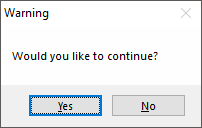

# MsgBox

Displays the specified text in a small window containing one or more buttons (such as Yes and No).

```ahk
MsgBox Text, Title, Options
Result := MsgBox(Text, Title, Options)
```

<a id="Parameters"></a>
## Parameters

**Text**

Type: [String](../Concepts.md#strings)

If omitted and "OK" is the only button present, it defaults to the string "Press OK to continue.". If omitted in any other case, it defaults to an empty string. Otherwise, specify the text to display inside the message box.

[Escape sequences](../misc/EscapeChar.md) can be used to denote special characters. For example, \`n indicates a linefeed character, which ends the current line and begins a new one. Thus, using ``"text1`n`ntext2"`` would create a blank line between text1 and text2.

If *Text* is long, it can be broken up into several shorter lines by means of a [continuation section](../Scripts.md#continuation), which might improve readability and maintainability.

**Title**

Type: [String](../Concepts.md#strings)

If omitted, it defaults to the current value of [A_ScriptName](../Variables.md#ScriptName). Otherwise, specify the title of the message box.

**Options**

Type: [String](../Concepts.md#strings)

If blank or omitted, it defaults to 0 (only an OK button is displayed). Otherwise, specify a combination (sum) of values or a string of one or more options from the tables below to indicate the type of message box and the possible button combinations.

In addition, zero or more of the following options can be specified:

<a id="OwnerOption"></a>

**Owner:** To specify an [owner window](#Owner) for the message box, use the word Owner followed immediately by a [HWND (window ID)](../misc/WinTitle.md#ahk_id).

<a id="Timeout"></a>

**T:** Timeout. To have the message box close automatically if the user has not closed it within a specified time, use the letter T followed by the timeout in seconds, which can contain a decimal point. If this value exceeds 2147483 (24.8 days), it will be set to 2147483. If the message box times out, the [return value](#Result) is the word Timeout.

<a id="Options"></a>
## Values for the *Options* parameter

The *Options* parameter can be either a combination (sum) of numeric values from the following groups, which is passed directly to the operating system's MessageBox function, or a string of zero or more case-insensitive options separated by at least one space or tab. One or more numeric options may also be included in the string.

<a id="Group_1_Buttons"></a>
### Group #1: Buttons

To indicate the buttons displayed in the message box, add <u>one</u> of the following values:

| Function | Dec | Hex | String |
| --- | ---: | ---: | --- |
| OK | 0 | 0x0 | `OK` or `O` |
| OK, Cancel | 1 | 0x1 | `OKCancel`, `O/C` or `OC` |
| Abort, Retry, Ignore | 2 | 0x2 | `AbortRetryIgnore`, `A/R/I` or `ARI` |
| Yes, No, Cancel | 3 | 0x3 | `YesNoCancel`, `Y/N/C` or `YNC` |
| Yes, No | 4 | 0x4 | `YesNo`, `Y/N` or `YN` |
| Retry, Cancel | 5 | 0x5 | `RetryCancel`, `R/C` or `RC` |
| Cancel, Try Again, Continue | 6 | 0x6 | `CancelTryAgainContinue`, `C/T/C` or `CTC` |

<a id="Group_2_Icon"></a>
### Group #2: Icon

To display an icon in the message box, add <u>one</u> of the following values:

| Function | Dec | Hex | String |
| --- | ---: | ---: | --- |
| Icon Hand (stop/error) | 16 | 0x10 | `Iconx` |
| Icon Question | 32 | 0x20 | `Icon?` |
| Icon Exclamation | 48 | 0x30 | `Icon!` |
| Icon Asterisk (info) | 64 | 0x40 | `Iconi` |

<a id="Group_3_Default_Button"></a>
### Group #3: Default Button

To indicate the default button, add <u>one</u> of the following values:

| Function | Dec | Hex | String |
| --- | ---: | ---: | --- |
| Makes the 2nd button the default | 256 | 0x100 | `Default2` |
| Makes the 3rd button the default | 512 | 0x200 | `Default3` |
| Makes the 4th button the default<br>(requires the [Help button](#Help) to be present) | 768 | 0x300 | `Default4` |

<a id="Group_4_Modality"></a>
### Group #4: Modality

To indicate the modality of the dialog box, add <u>one</u> of the following values:

| Function | Dec | Hex | String |
| --- | ---: | ---: | --- |
| System Modal (always on top) | 4096 | 0x1000 | N/A |
| Task Modal | 8192 | 0x2000 | N/A |
| Always-on-top (style WS_EX_TOPMOST)<br>(like System Modal but omits title bar icon) | 262144 | 0x40000 | N/A |

<a id="Group_5_Other_Options"></a>
### Group #5: Other Options

To specify other options, add <u>one or more</u> of the following values:

| Function | Dec | Hex | String |
| --- | ---: | ---: | --- |
| <a id="Help"></a>Adds a Help button (see remarks below) | 16384 | 0x4000 | N/A |
| Makes the text right-justified | 524288 | 0x80000 | N/A |
| Right-to-left reading order for Hebrew/Arabic | 1048576 | 0x100000 | N/A |

<a id="Result"></a>
## Return Value

Type: [String](../Concepts.md#strings)

This function returns one of the following strings to represent which button the user pressed:

- OK
- Cancel
- Yes
- No
- Abort
- Retry
- Ignore
- TryAgain
- Continue
- Timeout (that is, the word "timeout" is returned if the message box timed out)

If the dialog could not be displayed, an empty string is returned. This typically only occurs as a result of the [MsgBox limit](#max) being reached, but may occur in other unusual cases.

<a id="Error_Handling"></a>
## Error Handling

An [Error](Error.md) is thrown on failure, such as if the options are invalid, the [MsgBox limit](#max) has been reached, or the message box could not be displayed for some other reason.

<a id="Remarks"></a>
## Remarks

A message box usually looks like this:



To determine which button the user pressed, use the function's [return value](#Result). For example:

```ahk
Result := MsgBox("Would you like to continue? (press Yes or No)",, "YesNo")
if Result = "Yes"
    MsgBox "You pressed Yes."
else
    MsgBox "You pressed No."

if MsgBox("Retry or cancel?",, "R/C") = "Retry"
    MsgBox("You pressed Retry.")
```

To customize the names of the buttons, see [Changing MsgBox's Button Names](../scripts/index.md#MsgBoxButtonNames).

> **Note:** Pressing `Ctrl`+`C` while a message box is active will copy its text to the clipboard. This applies to all message boxes, not just those produced by AutoHotkey.

<a id="Owner"></a>

**Using MsgBox with GUI windows:** A GUI window may display a *modal* message box by means of the [OwnDialogs option](Gui.md#OwnDialogs). A *modal* message box prevents the user from interacting with the GUI window until the message box is dismissed. In such a case, it is not necessary to specify the System Modal or Task Modal options from the table above.

When the [OwnDialogs option](Gui.md#OwnDialogs) is *not* in effect, the Task Modal option (8192) can be used to disable all the script's windows until the user dismisses the message box.

If the `OwnerHWND` option is specified, it takes precedence over any other setting. *HWND* can be the [HWND](../misc/WinTitle.md#ahk_id) of any window, even one not owned by the script.

**The Help button:** When the Help button option (16384) is present in *Options*, pressing the Help button will have no effect unless both of the following are true:

1. The message box is owned by either the script's hidden [main window](../Program.md#main-window) (via the [Owner option](#OwnerOption)) or a GUI window (via the [OwnDialogs option](Gui.md#OwnDialogs)).
2. The script is monitoring the WM_HELP message (0x0053). For example: `OnMessage(0x0053, WM_HELP)`. When the WM_HELP function is called, it may guide the user by means such as showing another window or message box.

See [example #8](#ExHelpBtn) for a demonstration.

**The Close button (in the message box's title bar):** Since the message box is a built-in feature of the operating system, its X button is enabled only when certain buttons are present. If there is only an OK button, clicking the X button is the same as pressing OK. Otherwise, the X button is disabled unless there is a Cancel button, in which case clicking the X is the same as pressing Cancel.

<a id="max"></a>

**Maximum 7 ongoing calls:** The [thread](../misc/Threads.md) displaying a message box can typically be interrupted, allowing the new thread to display its own message box before the previous call returns. A maximum of 7 ongoing calls to MsgBox are permitted, but any calls beyond the 7th cause an [Error](Error.md) to be thrown. Note that a call to MsgBox in an interrupted thread cannot return until the thread is resumed.

<a id="Related"></a>
## Related

[InputBox](InputBox.md), [FileSelect](FileSelect.md), [DirSelect](DirSelect.md), [ToolTip](ToolTip.md), [Gui object](Gui.md)

<a id="Examples"></a>
## Examples

<a id="ExBasic"></a>

**Example:** Shows a message box with specific text. A quick and easy way to show information. The user can press an OK button to close the message box and continue execution.

```ahk
MsgBox "This is a string."
```

<a id="ExTitle"></a>

**Example:** Shows a message box with specific text and a title.

```ahk
MsgBox "This MsgBox has a custom title.", "A Custom Title"
```

<a id="ExNoParams"></a>

**Example:** Shows a message box with default text. Mainly useful for debugging purposes, for example to quickly set a breakpoint in the script.

```ahk
MsgBox ; "Press OK to continue."
```

<a id="ExContSec"></a>

**Example:** Shows a message box with specific text, a title and an info icon. Besides, a [continuation section](../Scripts.md#continuation) is used to display the multi-line text in a more clear manner.

```ahk
MsgBox "
  (
    The first parameter is displayed as the message.
    The second parameter becomes the window title.
    The third parameter determines the type of message box.
  )", "Window Title", "iconi"
```

<a id="ExRetValue"></a>

**Example:** Use the return value to determine which button the user pressed in the message box. Note that in this case the MsgBox function call must be specified with [parentheses](../Language.md#function-call-statements).

```ahk
result := MsgBox("Do you want to continue? (Press YES or NO)",, "YesNo")
if (result = "No")
    return
```

<a id="ExTimeout"></a>

**Example:** Use the T (timeout) option to automatically close the message box after a certain number of seconds.

```ahk
result := MsgBox("This MsgBox will time out in 5 seconds.  Continue?",, "Y/N T5")
if (result = "Timeout")
    MsgBox "You didn't press YES or NO within the 5-second period."
else if (result = "No")
    return
```

<a id="ExExpr"></a>

**Example:** Include a variable or sub-expression in the message. See also: [Concatenation](../Variables.md#concat)

```ahk
var := 10
MsgBox "The initial value is: " var
MsgBox "The result is: " var * 2
MsgBox Format("The result is: {1}", var * 2)
```

<a id="ExHelpBtn"></a>

**Example:** Shows how to make the [Help button](#Help) functional using the [Owner option](#OwnerOption) or the [Gui OwnDialogs option](Gui.md#OwnDialogs).

```ahk
OnMessage(0x0053, WM_HELP)
MsgBox("Press the Help button.", "Help button test", "0x4000 Owner" A_ScriptHwnd)
WM_HELP(*)
{
    MsgBox "Help button pressed."
}
```

```ahk
OnMessage(0x0053, WM_HELP)
MyGui := Gui()
MyGui.Add("Button",, "Show MsgBox").OnEvent("Click", ShowMsgBox)
MyGui.Show()

ShowMsgBox(*)
{
    MyGui.Opt("+OwnDialogs")
    MsgBox("Press the Help button.", "Help button test", 0x4000)
}

WM_HELP(*)
{
    MsgBox "Help button pressed."
}
```
