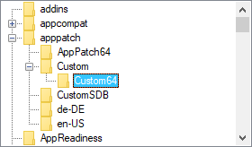

# TreeView

<a id="toc"></a>
## Table of Contents

- [Introduction and Simple Example](#Intro)
- [Parameters](#Parameters)
- [Built-in Methods](#BuiltIn)
- [Events](#Events)
- [ImageLists](#IL) (the means by which icons are added to a TreeView)
- [Remarks](#Remarks)
- [Examples](#Examples)

<a id="Intro"></a>
## Introduction and Simple Example

A TreeView displays a hierarchy of items by indenting child items beneath their parents. The most common example is Explorer's tree of drives and folders.

A TreeView usually looks like this:



The syntax for creating a TreeView is:

<a id="GuiAdd"></a>

```ahk
GuiCtrl := MyGui.Add("TreeView", Options)
GuiCtrl := MyGui.AddTreeView(Options)
```

Here is a working script that creates and displays a simple hierarchy of items:

```ahk
MyGui := Gui()
TV := MyGui.Add("TreeView")
P1 := TV.Add("First parent")
P1C1 := TV.Add("Parent 1's first child", P1)  ; Specify P1 to be this item's parent.
P2 := TV.Add("Second parent")
P2C1 := TV.Add("Parent 2's first child", P2)
P2C2 := TV.Add("Parent 2's second child", P2)
P2C2C1 := TV.Add("Child 2's first child", P2C2)

MyGui.Show()  ; Show the window and its TreeView.
```

<a id="Parameters"></a>
## Parameters

<a id="Options"></a>

**Options**

Type: [String](../Concepts.md#strings)

In addition to the [general options and styles](Gui.md#Add_Options), the following are supported or noteworthy:

**Background***Color*: Background color. Specify for *Color* a color name (see [color chart](../misc/Colors.md)) or RGB value (the 0x prefix is optional). Examples: `BackgroundSilver`, `BackgroundFFDD99`. If this option is not present, the TreeView initially defaults to the system's default background color. Specifying `BackgroundDefault` applies the system's default background color (usually white). For example, a TreeView can be restored to the default color via `TV.Opt("+BackgroundDefault")`.

**Buttons:** Specify `-Buttons` (minus Buttons) to avoid displaying a plus or minus button to the left of each item that has children.

**C***Color*: Text color. Specify for *Color* a color name (see [color chart](../misc/Colors.md)) or RGB value (the 0x prefix is optional). Examples: `cRed`, `cFF2211`, `c0xFF2211`, `cDefault`.

<a id="Checked"></a>

**Checked:** Provides a checkbox at the left side of each item. When [adding](#Add) an item, specify the word *Check* in its options to have the box to start off checked instead of unchecked. The user may either click the checkbox or press the spacebar to check or uncheck an item. To discover which items in a TreeView are currently checked, call the [GetNext](#GetNext) or [Get](#Get) methods.

**HScroll:** Specify `-HScroll` (minus HScroll) to disable horizontal scrolling in the control (in addition, the control will not display any horizontal scroll bar).

<a id="ImageList"></a>

**ImageList***ID*: This is the means by which icons are added to a TreeView. Specify for *ID* the ImageList ID returned from a previous call to [IL_Create](ListView.md#IL_Create). This option has an effect only when creating a TreeView. Alternatively, the [SetImageList](#SetImageList) method can be used without the limitation previously mentioned. For details, see [ImageLists](#IL).

**Lines:** Specify `-Lines` (minus Lines) to avoid displaying a network of lines connecting parent items to their children. However, removing these lines also prevents the plus/minus buttons from being shown for top-level items.

<a id="ReadOnly"></a>

**ReadOnly:** Specify `-ReadOnly` (minus ReadOnly) to allow editing of the text/name of each item. To edit an item, select it then press `F2` (see the [WantF2](#WantF2) option below). Alternatively, you can click an item once to select it, wait at least half a second, then click the same item again to edit it. After being edited, an item can be alphabetically repositioned among its siblings, as in [example #1](#ExEdit).

<a id="WantF2"></a>

**WantF2:** Specify `-WantF2` (minus WantF2) to prevent `F2` from [editing](#ReadOnly) the currently selected item. This setting is ignored unless [-ReadOnly](#ReadOnly) is also in effect.

**W***n*: Sets the width of the control. For example, specifying `w400` would make the control 400 pixels wide. If omitted, the default is 30 times the current font size.

**R***n* or **H***n*: Sets the height of the control. For example, specifying `r7` would make room for 7 rows inside the control, while `h400` would set the total height of the control to 400 pixels. If both R and H are omitted, the default is 5 rows.

**(Unnamed numeric styles):** Since styles other than the above are rarely used, they do not have names. See the [TreeView styles table](../misc/Styles.md#TreeView) for a list.

<a id="BuiltIn"></a>
## Built-in Methods for TreeViews

In addition to the [default methods/properties of a GUI control](GuiControl.md), this control type has the following methods:

Item methods:

- [Add](#Add): Adds a new item to the TreeView.
- [Modify](#Modify): Modifies the attributes and/or name of an item.
- [Delete](#Delete): Deletes the specified item or all items.

Retrieval methods:

- [GetSelection](#GetSelection): Returns the selected item's ID number.
- [GetCount](#GetCount): Returns the total number of items in the control.
- [GetParent](#GetParent): Returns the ID number of the specified item's parent.
- [GetChild](#GetChild): Returns the ID number of the specified item's first/top child.
- [GetPrev](#GetPrev): Returns the ID number of the sibling above the specified item.
- [GetNext](#GetNext): Returns the ID number of the next item below the specified item.
- [GetText](#GetText): Retrieves the text/name of the specified item.
- [Get](#Get): Returns the ID number of the specified item if it has the specified attribute.

Other methods:

- [SetImageList](#SetImageList): Sets or replaces an ImageList for displaying icons.

<a id="Add"></a>

### Add

Adds a new item to the TreeView.

```ahk
ItemID := TV.Add(Name, ParentItemID, Options)
```

<a id="Add_Parameters"></a>
#### Parameters

**Name**

Type: [String](../Concepts.md#strings)

The displayed text of the item, which can be text or numeric (including numeric [expression](../Variables.md#Expressions) results).

**ParentItemID**

Type: [Integer](../Concepts.md#numbers)

If omitted, it defaults to 0, meaning the item will be added at the top level. Otherwise, specify the ID number of the new item's parent.

<a id="Options_for_Add_and_Modify"></a>

**Options**

Type: [String](../Concepts.md#strings)

If blank or omitted, it defaults to no options. Otherwise, specify one or more options from the list below (not case-sensitive). Separate each option from the next with a space or tab. To remove an option, precede it with a minus sign. To add an option, a plus sign is permitted but not required.

<a id="Bold"></a>

**Bold:** Displays the item's name in a bold font. To later un-bold the item, use `TV.Modify(ItemID, "-Bold")`. The word *Bold* may optionally be followed immediately by a 0 or 1 to indicate the starting state.

<a id="Check"></a>

**Check:** Shows a checkmark to the left of the item (if the TreeView has [checkboxes](#Checked)). To later uncheck it, use `TV.Modify(ItemID, "-Check")`. The word *Check* may optionally be followed immediately by a 0 or 1 to indicate the starting state. In other words, both `"Check"` and `"Check" . VarContainingOne` are the same (the period used here is the [concatenation operator](../Variables.md#concat)).

<a id="Expand"></a>

**Expand:** Expands the item to reveal its children (if any). To later collapse the item, use `TV.Modify(ItemID, "-Expand")`. If there are no children, the [Modify](#Modify) method returns 0 instead of the item's ID. By contrast, the [Add](#Add) method marks the item as expanded in case children are added to it later. Unlike the [Select](#Select) option below, expanding an item does not automatically expand its parent. Finally, the word *Expand* may optionally be followed immediately by a 0 or 1 to indicate the starting state. In other words, both `"Expand"` and `"Expand" . VarContainingOne` are the same.

**First | Sort | N:** These options apply only to the [Add](#Add) method. They specify the new item's position relative to its siblings (a *sibling* is any other item on the same level). If none of these options is present, the new item is added as the last/bottom sibling. Otherwise, specify the word *First* to add the item as the first/top sibling, or specify the word *Sort* to insert it among its siblings in alphabetical order. If a plain integer *N* is specified, it is assumed to be ID number of the sibling after which to insert the new item (if *N* is the only option present, it does not have to be enclosed in quotes).

**Icon:** Specify the word *Icon* followed immediately by the number of this item's icon, which is displayed to the left of the item's name. If this option is absent, the first icon in the [ImageList](#IL) is used. To display a blank icon, specify a number that is larger than the number of icons in the ImageList. If the control lacks an ImageList, no icon is displayed nor is any space reserved for one.

<a id="Select"></a>

**Select:** Selects the item. Since only one item at a time can be selected, any previously selected item is automatically de-selected. In addition, this option reveals the newly selected item by expanding its parent(s), if necessary. To find out the current selection, call the [GetSelection](#GetSelection) method.

**Sort:** For the [Modify](#Modify) method, this option alphabetically sorts the children of the specified item. To instead sort all top-level items, use `TV.Modify(0, "Sort")`. If there are no children, 0 is returned instead of the ID of the modified item.

**Vis:** Ensures that the item is completely visible by scrolling the TreeView and/or expanding its parent, if necessary.

**VisFirst:** Same as above except that the TreeView is also scrolled so that the item appears at the top, if possible. This option is typically more effective when used with the [Modify](#Modify) method than with the [Add](#Add) method.

<a id="Add_Return_Value"></a>
#### Return Value

Type: [Integer](../Concepts.md#numbers)

On success, this method returns the unique ID number of the newly added item. On failure, it returns 0.

<a id="Add_Remarks"></a>
#### Remarks

When adding a large number of items, performance can be improved by using `TV.Opt("-Redraw")` before adding the items and `TV.Opt("+Redraw")` afterward. See [Redraw](GuiControl.md#Redraw) for more details.

<a id="Modify"></a>

### Modify

Modifies the attributes and/or name of an item.

```ahk
ItemID := TV.Modify(ItemID , Options, NewName)
```

<a id="Modify_Parameters"></a>
#### Parameters

**ItemID**

Type: [Integer](../Concepts.md#numbers)

The ID number of the item to modify.

**Options**

Type: [String](../Concepts.md#strings)

If this and the *NewName* parameter is omitted, the item will be selected. Otherwise, specify one or more options from the [list above](#Options_for_Add_and_Modify).

**NewName**

Type: [String](../Concepts.md#strings)

If omitted, the current name is left unchanged. Otherwise, specify the new name of the item.

<a id="Modify_Return_Value"></a>
#### Return Value

Type: [Integer](../Concepts.md#numbers)

This method returns the item's own ID.

<a id="Delete"></a>

### Delete

Deletes the specified item or all items.

```ahk
TV.Delete(ItemID)
```

<a id="Delete_Parameters"></a>
#### Parameters

**ItemID**

Type: [Integer](../Concepts.md#numbers)

If omitted, <u>all</u> items in the TreeView are deleted. Otherwise, specify the ID number of the item to delete.

<a id="GetSelection"></a>

### GetSelection

Returns the selected item's ID number.

```ahk
ItemID := TV.GetSelection()
```

<a id="GetSelection_Return_Value"></a>
#### Return Value

Type: [Integer](../Concepts.md#numbers)

This method returns the selected item's ID number.

<a id="GetCount"></a>

### GetCount

Returns the total number of items in the control.

```ahk
Count := TV.GetCount()
```

<a id="GetCount_Return_Value"></a>
#### Return Value

Type: [Integer](../Concepts.md#numbers)

This method returns the total number of items in the control. The value is always returned immediately because the control keeps track of the count.

<a id="GetParent"></a>

### GetParent

Returns the ID number of the specified item's parent.

```ahk
ParentItemID := TV.GetParent(ItemID)
```

<a id="GetParent_Parameters"></a>
#### Parameters

**ItemID**

Type: [Integer](../Concepts.md#numbers)

The ID number of the item to check.

<a id="GetParent_Return_Value"></a>
#### Return Value

Type: [Integer](../Concepts.md#numbers)

This method returns the ID number of the specified item's parent. If the item has no parent, it returns 0, which applies to all top-level items.

<a id="GetChild"></a>

### GetChild

Returns the ID number of the specified item's first/top child.

```ahk
ChildItemID := TV.GetChild(ItemID)
```

<a id="GetChild_Parameters"></a>
#### Parameters

**ItemID**

Type: [Integer](../Concepts.md#numbers)

The ID number of the item to check. If 0, the ID number of the first/top item in the TreeView is returned.

<a id="GetChild_Return_Value"></a>
#### Return Value

Type: [Integer](../Concepts.md#numbers)

This method returns the ID number of the specified item's first/top child. If there is no child, it returns 0.

<a id="GetPrev"></a>

### GetPrev

Returns the ID number of the sibling above the specified item.

```ahk
PrevItemID := TV.GetPrev(ItemID)
```

<a id="GetPrev_Parameters"></a>
#### Parameters

**ItemID**

Type: [Integer](../Concepts.md#numbers)

The ID number of the item to check.

<a id="GetPrev_Return_Value"></a>
#### Return Value

Type: [Integer](../Concepts.md#numbers)

This method returns the ID number of the sibling above the specified item. If there is no sibling, it returns 0.

<a id="GetNext"></a>

### GetNext

Returns the ID number of the next item below the specified item.

```ahk
NextItemID := TV.GetNext(ItemID, ItemType)
```

<a id="GetNext_Parameters"></a>
#### Parameters

**ItemID**

Type: [Integer](../Concepts.md#numbers)

If omitted, it defaults to 0, meaning the ID number of the first/top item in the TreeView is returned. Otherwise, specify the ID number of the item to check.

**ItemType**

Type: [String](../Concepts.md#strings)

If omitted, the ID number of the sibling below the specified item will be retrieved. Otherwise, specify one of the following strings:

**Full** or **F**: Retrieves the next item regardless of its relationship to the specified item. This allows the script to easily traverse the entire tree, item by item. See the example below.

**Check**, **Checked** or **C**: Gets only the next item with a checkmark.

<a id="GetNext_Return_Value"></a>
#### Return Value

Type: [Integer](../Concepts.md#numbers)

This method returns the ID number of the next item below the specified item. If there is no next item, it returns 0.

<a id="GetNext_Remarks"></a>
#### Remarks

The following example traverses the entire tree, item by item:

```ahk
ItemID := 0  ; Causes the loop's first iteration to start the search at the top of the tree.
Loop
{
    ItemID := TV.GetNext(ItemID, "Full")  ; Replace "Full" with "Checked" to find all checkmarked items.
    if not ItemID  ; No more items in tree.
        break
    ItemText := TV.GetText(ItemID)
    MsgBox('The next Item is ' ItemID ', whose text is "' ItemText '".')
}
```

<a id="GetText"></a>

### GetText

Retrieves the text/name of the specified item.

```ahk
Text := TV.GetText(ItemID)
```

<a id="GetText_Parameters"></a>
#### Parameters

**ItemID**

Type: [Integer](../Concepts.md#numbers)

The ID number of the item whose text to be retrieved.

<a id="GetText_Return_Value"></a>
#### Return Value

Type: [String](../Concepts.md#strings)

This method returns the retrieved text. Only up to 8191 characters are retrieved.

<a id="Get"></a>

### Get

Returns the ID number of the specified item if it has the specified attribute.

```ahk
ItemID := TV.Get(ItemID, Attribute)
```

<a id="Get_Parameters"></a>
#### Parameters

**ItemID**

Type: [Integer](../Concepts.md#numbers)

The ID number of the item to check.

**Attribute**

Type: [String](../Concepts.md#strings)

Specify one of the following strings:

**E**, **Expand** or **Expanded**: The item is currently [expanded](#Expand) (i.e. its children are being displayed).

**C**, **Check** or **Checked**: The item has a [checkmark](#Check).

**B** or **Bold**: The item is currently [bold](#Bold) in font.

<a id="Get_Return_Value"></a>
#### Return Value

Type: [Integer](../Concepts.md#numbers)

If the specified item has the specified attribute, its own ID is returned. Otherwise, 0 is returned.

<a id="Get_Remarks"></a>
#### Remarks

Since an IF-statement sees any non-zero value as "true", the following two lines are functionally identical: `if TV.Get(ItemID, "Checked") = ItemID` and `if TV.Get(ItemID, "Checked")`.

<a id="SetImageList"></a>

### SetImageList

Sets or replaces an [ImageList](#IL) for displaying icons.

```ahk
PrevImageListID := TV.SetImageList(ImageListID , IconType)
```

<a id="SetImageList_Parameters"></a>
#### Parameters

**ImageListID**

Type: [Integer](../Concepts.md#numbers)

The ID number returned from a previous call to [IL_Create](ListView.md#IL_Create).

**IconType**

Type: [Integer](../Concepts.md#numbers)

If omitted, it defaults to 0. Otherwise, specify 2 for state icons (which are not yet directly supported, but could be used via [SendMessage](SendMessage.md)).

<a id="SetImageList_Return_Value"></a>
#### Return Value

Type: [Integer](../Concepts.md#numbers)

On success, this method returns the ImageList ID that was previously associated with the TreeView. On failure, it returns 0. Any such detached ImageList should normally be destroyed via [IL_Destroy](ListView.md#IL_Destroy).

<a id="Events"></a>
## Events

The following events can be detected by calling [GuiControl.OnEvent](GuiControl.md#OnEvent) to register a callback function or method:

| Event | Raised when... |
| --- | --- |
| [Click](GuiOnEvent.md#Click) | The control is clicked. |
| [DoubleClick](GuiOnEvent.md#DoubleClick) | The control is double-clicked. |
| [ContextMenu](GuiOnEvent.md#Ctrl-ContextMenu) | The user right-clicks the control or presses `Menu` or `Shift`+`F10` while the control has the keyboard focus. |
| [Focus](GuiOnEvent.md#Focus) | The control gains the keyboard focus. |
| [LoseFocus](GuiOnEvent.md#LoseFocus) | The control loses the keyboard focus. |
| [ItemCheck](GuiOnEvent.md#ItemCheck) | An item is checked or unchecked. |
| [ItemEdit](GuiOnEvent.md#ItemEdit) | An item's label is edited by the user. |
| [ItemExpand](GuiOnEvent.md#ItemExpand) | An item is expanded or collapsed. |
| [ItemSelect](GuiOnEvent.md#ItemSelect) | An item is selected. |

Additional (rarely-used) notifications can be detected by using [GuiControl.OnNotify](GuiControl.md#OnNotify). These notifications are [documented at Microsoft Docs](https://learn.microsoft.com/windows/win32/controls/bumper-tree-view-control-reference-notifications). Microsoft Docs does not show the numeric value of each notification code; those can be found in the Windows SDK or by searching the Internet.

<a id="IL"></a>
## ImageLists

An Image-List is a group of identically sized icons stored in memory. Upon creation, each ImageList is empty. The script calls [IL_Add](ListView.md#IL_Add) repeatedly to add icons to the list, and each icon is assigned a sequential number starting at 1. This is the number to which the script refers to display a particular icon to the left of an item's name. Here is a working example that demonstrates how to put icons into a TreeView:

```ahk
MyGui := Gui()
ImageListID := IL_Create(10)  ; Create an ImageList with initial capacity for 10 icons.
Loop 10  ; Load the ImageList with some standard system icons.
    IL_Add(ImageListID, "shell32.dll", A_Index)
TV := MyGui.Add("TreeView", "ImageList" . ImageListID)
TV.Add("Name of Item", 0, "Icon4")  ; Add an item to the TreeView and give it a folder icon.
MyGui.Show()
```

The [SetImageList](#SetImageList) method can be used as an alternative to the [ImageList](#ImageList) option.

For detailed information about all ImageList functions, check out the [ListView page](ListView.md#IL).

<a id="ILremarks"></a>

Unlike [ListViews](ListView.md), a TreeView's ImageList is not automatically destroyed when the TreeView is destroyed. Therefore, a script should call [IL_Destroy](ListView.md#IL_Destroy) after destroying a TreeView's window if the ImageList will not be used for anything else. However, this is not necessary if the script will soon be exiting because all ImageLists are automatically destroyed at that time.

<a id="Remarks"></a>
## Remarks

<a id="Enter"></a>

To detect when the user has pressed `Enter` while a TreeView has focus, use a [default button](GuiControls.md#DefaultButton) (which can be hidden if desired). For example:

```ahk
MyGui.Add("Button", "Hidden Default", "OK").OnEvent("Click", ButtonOK)
...
ButtonOK(*) {
    global
    if MyGui.FocusedCtrl != TV
        return
    MsgBox("Enter was pressed. The selected item ID is " TV.GetSelection())
}
```

In addition to navigating from item to item with the keyboard, the user may also perform incremental search by typing the first few characters of an item's name. This causes the selection to jump to the nearest matching item.

Although any length of text can be stored in each item of a TreeView, only the first 260 characters are displayed.

Although the theoretical maximum number of items in a TreeView is 65536, item-adding performance will noticeably decrease long before then. This can be alleviated somewhat by using the redraw tip described in the [Add](#Add) method.

A script may create more than one TreeView per window.

To perform actions such as resizing, hiding, or changing the font of a TreeView, see the [GuiControl](GuiControl.md) object.

<a id="Related"></a>
## Related

[ListView](ListView.md), [Other Control Types](GuiControls.md), [Gui()](Gui.md#Call), [ContextMenu event](GuiOnEvent.md#ContextMenu), [Gui object](GuiControl.md), [GuiControl object](GuiControl.md), [TreeView styles table](../misc/Styles.md#TreeView)

<a id="Examples"></a>
## Examples

<a id="ExEdit"></a>

**Example:** Creates and displays an [editable](#ReadOnly) TreeView containing three items. The TreeView uses [GuiControl.OnEvent](GuiControl.md#OnEvent) to process user input. In this case, whenever the user finishes editing an item, it is repositioned alphabetically among its siblings. To test this example, edit an item with `F2` or a delayed double-click.

```ahk
MyGui := Gui()
TV := MyGui.Add("TreeView", "-ReadOnly")
TV.Add("A")
TV.Add("B")
TV.Add("C")
TV.OnEvent("ItemEdit", TV_Edit)  ; Call TV_Edit whenever we finish editing an item.
MyGui.Show()

TV_Edit(TV, Item)
{
    TV.Modify(TV.GetParent(Item), "Sort")  ; This works even if the item has no parent.
}
```

<a id="ExAdvanced"></a>

**Example:** The following is a working script that is more elaborate than the one near the top of this page. It creates and displays a TreeView containing all folders in the all-users Start Menu. When the user selects a folder, its contents are shown in a [ListView](GuiControls.md#ListView) to the right (like Windows Explorer). In addition, a [StatusBar](GuiControls.md#StatusBar) control shows information about the currently selected folder.

```ahk
; The following folder will be the root folder for the TreeView. Note that loading might take a long
; time if an entire drive such as C:\ is specified:
TreeRoot := A_MyDocuments
TreeViewWidth := 280
ListViewWidth := A_ScreenWidth/2 - TreeViewWidth - 30

; Create the Gui window and display the source directory (TreeRoot) in the title bar:
MyGui := Gui("+Resize", TreeRoot)  ; Allow the user to maximize or drag-resize the window.

; Create an ImageList and put some standard system icons into it:
ImageListID := IL_Create(5)
Loop 5
    IL_Add(ImageListID, "shell32.dll", A_Index)
; Create a TreeView and a ListView side-by-side to behave like Windows Explorer:
TV := MyGui.Add("TreeView", "r20 w" TreeViewWidth " ImageList" ImageListID)
LV := MyGui.Add("ListView", "r20 w" ListViewWidth " x+10", ["Name", "Modified"])

; Create a status bar to give info about the number of files and their total size:
SB := MyGui.Add("StatusBar")
SB.SetParts(60, 85)  ; Create three parts in the bar (the third part fills all the remaining width).

; Add folders and their subfolders to the tree. Display the status in case loading takes a long time:
M := Gui("ToolWindow -SysMenu Disabled AlwaysOnTop", "Loading the tree..."), M.Show("w200 h0")
DirList := AddSubFoldersToTree(TreeRoot, Map())
M.Hide()

; Call TV_ItemSelect whenever a new item is selected:
TV.OnEvent("ItemSelect", TV_ItemSelect)

; Call Gui_Size whenever the window is resized:
MyGui.OnEvent("Size", Gui_Size)

; Set the ListView's column widths (this is optional):
Col2Width := 70  ; Narrow to reveal only the YYYYMMDD part.
LV.ModifyCol(1, ListViewWidth - Col2Width - 30)  ; Allows room for vertical scrollbar.
LV.ModifyCol(2, Col2Width)

; Display the window. The OS will notify the script whenever the user performs an eligible action:
MyGui.Show()

AddSubFoldersToTree(Folder, DirList, ParentItemID := 0)
{
    ; This function adds to the TreeView all subfolders in the specified folder
    ; and saves their paths associated with an ID into an object for later use.
    ; It also calls itself recursively to gather nested folders to any depth.
    Loop Files, Folder "\*.*", "D"  ; Retrieve all of Folder's sub-folders.
    {
        ItemID := TV.Add(A_LoopFileName, ParentItemID, "Icon4")
        DirList[ItemID] := A_LoopFilePath
        DirList := AddSubFoldersToTree(A_LoopFilePath, DirList, ItemID)
    }
    return DirList
}

TV_ItemSelect(thisCtrl, Item)  ; This function is called when a new item is selected.
{
    ; Put the files into the ListView:
    LV.Delete()  ; Clear all rows.
    LV.Opt("-Redraw")  ; Improve performance by disabling redrawing during load.
    TotalSize := 0  ; Init prior to loop below.
    Loop Files, DirList[Item] "\*.*"  ; For simplicity, omit folders so that only files are shown in the ListView.
    {
        LV.Add(, A_LoopFileName, A_LoopFileTimeModified)
        TotalSize += A_LoopFileSize
    }
    LV.Opt("+Redraw")

    ; Update the three parts of the status bar to show info about the currently selected folder:
    SB.SetText(LV.GetCount() " files", 1)
    SB.SetText(Round(TotalSize / 1024, 1) " KB", 2)
    SB.SetText(DirList[Item], 3)
}

Gui_Size(thisGui, MinMax, Width, Height)  ; Expand/Shrink ListView and TreeView in response to the user's resizing.
{
    if MinMax = -1  ; The window has been minimized.  No action needed.
        return
    ; Otherwise, the window has been resized or maximized. Resize the controls to match.
    TV.GetPos(,, &TV_W)
    TV.Move(,,, Height - 30)  ; -30 for StatusBar and margins.
    LV.Move(,, Width - TV_W - 30, Height - 30)
}
```
